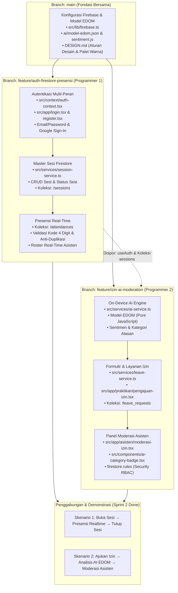

# SRS — Software Requirements Specification (Sprint 2)
## Data Dinamis dengan Firebase Authentication, Cloud Firestore, dan Integrasi AI

**Nama Aplikasi:** PPK LabPortal — Sistem Presensi, Pengelolaan Sesi & Moderasi Izin Praktikum  
**Institusi:** Departemen Informatika, Fakultas Sains dan Matematika, Universitas Diponegoro (UNDIP)  
**Mata Kuliah / Praktikum:** Praktikum Pengembangan Platform Khusus (PPK)  
**Fokus Pengembangan:** Transisi dari data dummy/lokal (Sprint 1) menuju multi-user cloud berbasis Firebase (Authentication & Cloud Firestore) serta integrasi model AI resmi pengajar (Model EDOM on-device pure JavaScript) untuk pendukung keputusan izin praktikum.  
**Platform Target:** Android (Expo Go & Production Build), iOS, dan Web Browser modern.  
**Strategi Kolaborasi:** Pembagian kerja terpisah menjadi 2 sub-tim pengembang independen (Programmer 1 dan Programmer 2) dengan branch Git berformat `feature/`.

---

## 1. Pendahuluan & Ringkasan Perubahan Arsitektur

### 1.1 Latar Belakang Masalah
Pada Sprint 1, aplikasi telah berhasil mendemonstrasikan antarmuka interaktif dan alur kegiatan praktikum dari dua sudut pandang pengguna (Praktikan dan Asisten). Namun, seluruh data jadwal, kehadiran, dan identitas masih tersimpan dalam memori lokal (*in-memory React Context*). Kondisi ini menyebabkan:
1. Data tidak permanen (hilang ketika aplikasi ditutup atau di-reload).
2. Tidak terhubung antar-pengguna (perubahan status sesi oleh asisten di perangkatnya tidak langsung tercermin di perangkat praktikan).
3. Tidak tersedianya kanal pengajuan izin bagi praktikan yang berhalangan hadir.
4. Asisten harus memeriksa alasan ketidakhadiran secara manual tanpa bantuan sistem analisis awal.

### 1.2 Tujuan Sprint 2
Sprint 2 mentransformasi PPK LabPortal menjadi sistem komputasi bergerak *cloud-connected* multi-pengguna yang:
1. Mengamankan autentikasi pengguna secara mandiri menggunakan **Firebase Authentication**.
2. Menyimpan dan menyinkronkan seluruh entitas secara persisten dan real-time menggunakan **Cloud Firestore**.
3. Menyediakan modul pengajuan izin bagi praktikan yang terintegrasi dengan **Model AI Resmi Pengajar (Model EDOM on-device)** untuk klasifikasi kategori alasan secara otomatis dan offline.
4. Memberikan fasilitas bagi asisten untuk meninjau rekomendasi AI dan mengambil keputusan akhir persetujuan izin secara transparan.
5. Menjamin keamanan data menggunakan **Firebase Security Rules** berbasis peran (*Role-Based Access Control*).

### 1.3 Kepatuhan Desain Mutlak (Mandatory Compliance to DESIGN.md)
Setiap pengembang (Programmer 1 dan Programmer 2) maupun asisten AI (*AI coding agent* seperti Copilot, Claude, Gemini, ChatGPT) yang mengimplementasikan kode pada Sprint 2 **WAJIB MENGIKUTI DAN MEMATUHI PANDUAN RESMI DI `DESIGN.md`**.  
Tujuan aturan ini adalah mencegah rusaknya konsistensi antarmuka (*UI breakage / visual slop*) ketika kode di-generate atau dimodifikasi oleh AI:
1. **Identitas Warna Peran:**
   - **Portal Praktikan:** Dominan aksen **Terracotta Orange** (`#EA580C`, tint `#FFF7ED`, border `#FED7AA`).
   - **Portal Asisten:** Dominan aksen **Academic Teal** (`#0D9488`, tint `#F0FDFA`, border `#99F6E4`).
   - **Kanvas & Permukaan:** Canvas netral **Slate Light** (`#F8FAFC`), permukaan kartu `#FFFFFF`, border halus `#E2E8F0`.
2. **Aturan Anti-Slop (Zero Generic Emojis):**
   - **DILARANG KERAS** menggunakan icon emoji generik di dalam UI, tombol, chip status, placeholder, teks modal, maupun notifikasi.
   - Gunakan simbol geometris rapi (`●`, `←`, `→`, `▲`, `▼`), inisial bulat (*avatar circle*), atau teks semantik tegas.
3. **Standar Responsivitas & Flexbox:**
   - Seluruh layar baru (Login, Register, Pengajuan Izin, Moderasi Izin) wajib memiliki pembatas lebar konten desktop: `maxWidth: 960px` terpusat (`alignSelf: 'center'`).
   - Padding adaptif: `paddingHorizontal: Platform.OS === 'web' ? 20 : 14`.
4. **Token Konsistensi Desain:**
   - Sudut melengkung seragam: `cardRadius: 14`, `buttonRadius: 10`, `pillRadius: 20`, `modalRadius: 20`.
   - Area sentuh minimal: `minHeight: 44` untuk kenyamanan pengguna perangkat mobile.

---

## 2. Arsitektur Sistem & Ekosistem Teknologi

```
+-----------------------------------------------------------------------------------+
|                                 CLIENT LAYER                                      |
|                       React Native + Expo SDK 57 (Expo Router)                    |
|                                                                                   |
|   +------------------------------------+   +----------------------------------+   |
|   |         PORTAL PRAKTIKAN           |   |       PORTAL ASISTEN LAB         |   |
|   | - Lihat Jadwal & Kelas Saya        |   | - CRUD Sesi & Roster Kelas       |   |
|   | - Presensi Mandiri (Kode 4 Digit)  |   | - Buka/Tutup Sesi Real-Time      |   |
|   | - Form Pengajuan Izin Praktikum    |   | - Rekapitulasi Presensi          |   |
|   | - Riwayat & Pantauan Status Izin   |   | - Verifikasi & Moderasi Izin     |   |
|   +-----------------+------------------+   +-----------------+----------------+   |
|                     |                                        |                    |
|                     +-------------------+--------------------+                    |
|                                         |                                         |
|                +------------------------v------------------------+                |
|                |              APPLICATION STATE & HOOKS          |                |
|                | - AuthContext (Firebase Auth Session)           |                |
|                | - Firestore Listeners (onSnapshot Subscriptions)|                |
|                | - Network & Offline Resilience Interceptors     |                |
|                +------------+-----------------------+------------+                |
+-----------------------------|-----------------------|-----------------------------+
                              |                       |
                              v                       v
+-----------------------------------+   +-------------------------------------------+
|          FIREBASE BACKEND         |   |         LOCAL ON-DEVICE AI ENGINE         |
|                                   |   |                                           |
|  1. Firebase Authentication       |   |  Model AI Resmi Pengajar (Model EDOM)     |
|     - Email/Password & Google     |   |  - Berkas: ai/model-edom.json & sentiment |
|     - Session Token Management    |   |  - Pure JavaScript Inference (100% Offline|
|                                   |   |  - Analisis Sentimen & Kategori Alasan    |
|  2. Cloud Firestore Database      |   |  - Zero Network Latency & Zero Cost       |
|     - Collections:                |   |                                           |
|       * users                     |   |  * Prinsip: AI hanya sebagai pendukung,   |
|       * sessions                  |   |    bukan pengambil keputusan otomatis.    |
|       * attendances               |   +-------------------------------------------+
|       * leave_requests            |
|  3. Firebase Security Rules       |
|     - Granular RBAC (Deployed)    |
+-----------------------------------+
```

---

## 3. Skema Data Cloud Firestore (Single Source of Truth)

Seluruh entitas database dirancang menggunakan struktur NoSQL datar (*flat collections*) dengan relasi berbasis identitas unik untuk mempermudah *real-time listener* dan pengindeksan majemuk (*compound query*).

### 3.1 Koleksi `users` (`/users/{uid}`)
Menyimpan profil pengguna yang terikat langsung dengan UID Firebase Authentication:
```typescript
export interface UserDocument {
  uid: string;              // Primary key dari Firebase Auth UID
  email: string;            // Format: mahasiswa@alumni.undip.ac.id
  nama: string;             // Nama lengkap pengguna
  peran: 'praktikan' | 'asisten'; // Hak akses pengguna
  nim?: string;             // 14 digit NIM resmi (khusus praktikan: mis. 24060122130001)
  kelas?: 'A' | 'B';        // Penempatan kelas praktikum (khusus praktikan)
  peranLab?: string;        // mis. 'Pengampu Lab Komputasi' (khusus asisten)
  createdAt: string;        // ISO 8601 Timestamp
  updatedAt: string;        // ISO 8601 Timestamp
}
```

### 3.2 Koleksi `sessions` (`/sessions/{sessionId}`)
Menyimpan jadwal dan siklus operasional sesi praktikum:
```typescript
export interface SessionDocument {
  id: string;               // Document ID
  praktikum: string;        // Nama mata praktikum (mis. 'Praktikum PPK')
  kelas: 'Kelas A' | 'Kelas B'; // Kelas target
  materi: string;           // Materi modul (mis. 'Modul 5: Firebase & AI')
  tanggal: string;          // Tanggal pelaksanaan (mis. '12 Nov 2026')
  waktuMulai: string;       // Jam mulai WIB (mis. '07.30')
  waktuSelesai: string;     // Jam selesai WIB (mis. '09.30')
  ruang: string;            // Ruang lab (mis. 'Lab Komputasi 1')
  status: 'belum-dibuka' | 'dibuka' | 'ditutup'; // Status sesi
  kodeSesi: string;         // 4 digit kode numerik sesi aktif (mis. '4821')
  createdBy: string;        // UID asisten pembuat
  openedAt?: string;        // ISO timestamp saat sesi dibuka
  closedAt?: string;        // ISO timestamp saat sesi ditutup
  createdAt: string;        // ISO timestamp
  updatedAt: string;        // ISO timestamp
}
```

### 3.3 Koleksi `attendances` (`/attendances/{attendanceId}`)
Mencatat presensi kehadiran mahasiswa secara real-time. Memiliki indeks komposit unik: `sessionId` + `studentId` untuk menjamin anti-duplikasi:
```typescript
export interface AttendanceDocument {
  id: string;               // Document ID (Format: `${sessionId}_${studentId}`)
  sessionId: string;        // Relasi ke koleksi sessions
  studentId: string;        // UID mahasiswa dari koleksi users
  studentName: string;      // Denormalisasi nama untuk query cepat
  studentNim: string;       // Denormalisasi NIM
  studentClass: 'A' | 'B';  // Kelas mahasiswa
  waktuKehadiran: string;   // Format tampilan lokal: '12 Nov 2026, 07:42:15 WIB'
  timestamp: number;        // Unix epoch timestamp (ms) untuk sorting akurat
  catatan?: string;         // Catatan opsional dari praktikan
  deviceInfo?: string;      // Metadata perangkat (Platform OS)
  verifiedByCode: boolean;  // Menandakan validitas kode 4 digit
}
```

### 3.4 Koleksi `leave_requests` (`/leave_requests/{requestId}`)
Menyimpan pengajuan izin ketidakhadiran praktikum beserta rekomendasi klasifikasi AI:
```typescript
export type LeaveStatus = 'menunggu' | 'disetujui' | 'ditolak';
export type AICategory = 'Sakit' | 'Akademik' | 'Keluarga' | 'Lainnya';

export interface LeaveRequestDocument {
  id: string;               // Document ID
  sessionId: string;        // Relasi ke sesi praktikum
  sessionName: string;      // Denormalisasi nama modul
  studentId: string;        // UID praktikan pemohon
  studentName: string;      // Denormalisasi nama praktikan
  studentNim: string;       // Denormalisasi NIM
  studentClass: 'A' | 'B';  // Kelas praktikan
  alasan: string;           // Deskripsi alasan tertulis dari praktikan
  lampiranUrl?: string;     // URL berkas bukti/surat izin (opsional)
  status: LeaveStatus;      // Status verifikasi: 'menunggu' | 'disetujui' | 'ditolak'
  
  // Hasil Analisis Model AI Pengajar (Decision Support Metadata)
  aiClassification: {
    category: AICategory;   // Kategori hasil prediksi model
    confidence: number;     // Nilai kepercayaan model (0.00 - 1.00)
    rawSummary?: string;    // Ringkasan analisis dari API AI
    processedAt: string;    // Timestamp pemrosesan AI
    isFallback: boolean;    // Menandai jika AI sedang offline dan memakai fallback
  };

  // Keputusan Asisten Laboratorium (Human in the Loop)
  reviewedBy?: string;      // UID asisten peninjau
  reviewerName?: string;    // Nama asisten peninjau
  reviewNotes?: string;     // Catatan/alasan keputusan asisten
  reviewedAt?: string;      // ISO timestamp saat keputusan diambil
  
  createdAt: string;        // ISO timestamp pengajuan
  updatedAt: string;        // ISO timestamp pembaruan
}
```

---

## 4. Matriks Pembagian Tanggung Jawab Tim & Alur Kerja

Agar pengerjaan Sprint 2 berjalan paralel, terstruktur, dan terhindar dari konflik kode (*zero merge conflicts*), arsitektur dibagi menjadi dua modul kerja independen dengan batasan tanggung jawab yang tegas:



### 4.1 Tabel Matriks Pembagian Tugas Lengkap

| No | Modul / Fitur | Programmer | Branch Git | Berkas yang Dimiliki / Diubah | Spesifikasi Logika Kunci | Kriteria Lolos (Definition of Done) |
|---|---|---|---|---|---|---|
| 1 | **Fondasi Firebase & Autentikasi** | **Programmer 1** | `feature/auth-firestore-presensi` | - `src/lib/firebase.ts`<br>- `src/context/auth-context.tsx`<br>- `src/app/login.tsx`<br>- `src/app/register.tsx` | • Login/Register Email + Password.<br>• Sign-In with Google.<br>• Role router guard (Asisten vs Praktikan).<br>• Persistensi sesi login di perangkat. | Berhasil register akun praktikan (NIM + Kelas) & asisten; berhasil login & redirect sesuai peran. |
| 2 | **Master Sesi Praktikum (CRUD)** | **Programmer 1** | `feature/auth-firestore-presensi` | - `src/services/session-service.ts`<br>- `src/app/asisten/jadwal.tsx`<br>- `src/app/asisten/detail-sesi/[id].tsx` | • CRUD koleksi `/sessions` di Firestore.<br>• Generate kode numerik 4 digit otomatis.<br>• Buka/tutup sesi praktikum secara real-time. | Data sesi tersimpan persisten di Firestore; perubahan status memicu pembaruan instan. |
| 3 | **Presensi & Roster Real-Time** | **Programmer 1** | `feature/auth-firestore-presensi` | - `src/app/praktikan/jadwal.tsx`<br>- `src/app/praktikan/detail-sesi/[id].tsx`<br>- `src/components/sesi-card.tsx` | • Input kode 4 digit & validasi kesesuaian.<br>• Anti-duplikasi ID: `${sessionId}_${studentId}`.<br>• Listener `onSnapshot` roster kehadiran asisten. | Praktikan hanya bisa presensi 1x pada sesi yang dibuka; daftar hadir asisten ter-update live. |
| 4 | **Mesin Inferensi AI On-Device** | **Programmer 2** | `feature/izin-ai-moderation` | - `src/services/ai-service.ts`<br>- `ai/sentiment.js`<br>- `ai/model-edom.json` | • Inferensi lokal JavaScript model EDOM resmi.<br>• Ekstraksi sentimen (`negatif`/`netral`/`positif`).<br>• Klasifikasi 4 kategori: Sakit, Akademik, Keluarga, Lainnya. | Analisis berjalan murni lokal (< 20ms, offline); menghasilkan sentimen, kategori, dan skor keyakinan. |
| 5 | **Formulir Pengajuan Izin** | **Programmer 2** | `feature/izin-ai-moderation` | - `src/app/praktikan/pengajuan-izin.tsx`<br>- `src/services/leave-service.ts` | • Pilih sesi berhalangan & input alasan (min 10 karakter).<br>• Integrasi analisis AI lokal sebelum submit.<br>• Simpan ke Firestore `/leave_requests` status `menunggu`. | Pengajuan izin tersimpan di Firestore dengan metadata AI terlampir; status awal `menunggu`. |
| 6 | **Badge Rekomendasi AI** | **Programmer 2** | `feature/izin-ai-moderation` | - `src/components/ai-category-badge.tsx` | • Tampilan visual: `[AI: <Kategori> • <Confidence>%]`.<br>• Palet warna sesuai DESIGN.md (Sakit Merah, Akademik Biru, dll).<br>• Anti-slop: Tanpa icon emoji generik. | Badge ter-render rapi dan konsisten pada layar pengajuan dan kartu moderasi asisten. |
| 7 | **Panel Moderasi Izin Asisten** | **Programmer 2** | `feature/izin-ai-moderation` | - `src/app/asisten/moderasi-izin.tsx`<br>- `src/components/leave-card.tsx` | • Listener live antrean izin berstatus `menunggu`.<br>• Tampilkan kartu pengajuan + rekomendasi AI.<br>• Aksi: Setujui Izin atau Tolak Izin (+ catatan).<br>• Human-in-the-loop: AI hanya pemberi rekomendasi. | Asisten dapat menerima/menolak izin; status ter-update di Firestore dan langsung terlihat oleh praktikan. |
| 8 | **Pantauan Riwayat & Rekap Izin** | **Programmer 2** | `feature/izin-ai-moderation` | - `src/app/praktikan/riwayat.tsx`<br>- `src/app/asisten/rekap.tsx` | • Tab status pengajuan izin praktikan.<br>• Mahasiswa berstatus `disetujui` tercatat izin pada rekap kehadiran kelas (bukan alpa). | Praktikan melihat status permohonannya secara live; rekapitulasi kehadiran kelas akurat. |
| 9 | **Keamanan Firestore Rules** | **Programmer 2** | `feature/izin-ai-moderation` | - `firestore.rules`<br>- `firebase.json` | • Role-Based Access Control (RBAC) pada Firestore.<br>• Praktikan hanya bisa tulis izin & presensi miliknya.<br>• Hanya asisten yang berhak mengubah sesi dan status izin. | Aturan terpasang di Firebase Cloud Console dan teruji menolak akses yang tidak sah. |

### 4.2 Kontrak Antarmuka Dependensi (Interface Contract)
Untuk memastikan kedua programmer dapat bekerja simultan tanpa saling memblokir:
1. **Penyedia (Programmer 1):**
   - Mengekspor hook `useAuth()` yang menyediakan: `{ user, userDoc, loading, logout }`.
   - Menjaga skema dokumen `/sessions` agar selalu memiliki field: `id`, `materi`, `kelas`, `status`, `kodeSesi`.
2. **Pengonsumsi (Programmer 2):**
   - Menggunakan `useAuth()` untuk mendapatkan identitas praktikan (`userDoc.uid`, `userDoc.nama`, `userDoc.nim`, `userDoc.kelas`) saat mengajukan izin.
   - Mengambil daftar sesi dari koleksi `/sessions` untuk pilihan dropdown sesi yang ingin dimohonkan izin.

---

## 5. Rincian Kebutuhan Fungsional — Programmer 1
### (Branch: `feature/auth-firestore-presensi`)

Programmer 1 bertanggung jawab atas fondasi koneksi Firebase, sistem autentikasi multi-peran, sinkronisasi CRUD sesi ke Firestore, dan pencatatan presensi real-time.

### FR-P1-01 — Konfigurasi Firebase SDK & Koneksi Cloud
- **FR-P1-01.1:** Menginisialisasi Firebase App menggunakan Firebase Web SDK modular (v10/v11) di `src/lib/firebase.ts`.
- **FR-P1-01.2:** Menghubungkan Firebase Authentication dengan persistensi sesi AsyncStorage/Local Storage agar sesi login tetap bertahan saat aplikasi dibuka kembali.
- **FR-P1-01.3:** Menginisialisasi Cloud Firestore dengan opsi cache offline aktif untuk ketahanan koneksi jaringan.

### FR-P1-02 — Registrasi & Autentikasi Multi-Metode (Email/Password & Google Account)
Sistem mendukung **2 metode autentikasi** yang terintegrasi penuh dengan Firebase Authentication dan Cloud Firestore:

- **FR-P1-02.1 (Metode 1 — Pendaftaran & Login Email/Password):**
  - Menyediakan formulir pendaftaran manual (`/register`) dengan masukan: Nama Lengkap, Email institusi/pribadi, Password (minimal 6 karakter), serta Pilihan Peran (`Praktikan` atau `Asisten`).
  - Jika mendaftar sebagai **Praktikan**, pengguna wajib melengkapi data akademik: NIM resmi 14 digit (format UNDIP `240601...`) dan pilihan Kelas praktikum (`A` atau `B`).
  - Menyimpan akun ke Firebase Authentication via `createUserWithEmailAndPassword`, kemudian membuat dokumen profil pengguna di Firestore `/users/{uid}`.

- **FR-P1-02.2 (Metode 2 — Sign-In with Google Account):**
  - Menyediakan tombol cepat **"Masuk dengan Akun Google"** pada layar login (`/login`) dan register (`/register`).
  - Mengautentikasi pengguna menggunakan Firebase `signInWithPopup` / Google Auth Provider.
  - **Penanganan Pengguna Baru (First-Time Google Sign-In):** Jika akun Google belum terdaftar di koleksi Firestore `/users/{uid}`, sistem akan memunculkan dialog/layar modal *Lengkapi Profil Pengguna* untuk memilih Peran (`Praktikan` atau `Asisten`) serta memasukkan NIM dan Kelas bagi mahasiswa.
  - **Penanganan Pengguna Lama:** Jika akun Google sudah terdaftar di Firestore, sistem langsung membaca profil pengguna dan mengarahkan ke dashboard yang sesuai tanpa perlu input ulang.

- **FR-P1-02.3 (Standar Desain Antarmuka Auth — Sesuai DESIGN.md):**
  - **Dimensi Kartu:** Di web desktop, kartu form dibungkus kontainer terpusat elegan dengan lebar maksimal `maxWidth: 440px` (`alignSelf: 'center'`).
  - **Warna & Permukaan:** Latar kanvas netral `#F8FAFC`, permukaan kartu `#FFFFFF` dengan `borderRadius: 14`, garis batas halus `borderColor: '#E2E8F0'`.
  - **Tombol & Area Sentuh:** Seluruh tombol memiliki `minHeight: 44`, `borderRadius: 10`, teks tebal `fontWeight: '700'`. Tombol utama menggunakan aksen Terracotta Orange (`#EA580C`), tombol Google menggunakan border `#CBD5E1` berlatar putih.
  - **Aturan Anti-Slop Mutlak:** DILARANG KERAS menggunakan emoji di placeholder, label, notifikasi, maupun tombol. Gunakan simbol geometris rapi (`●`, `←`, `→`).

### FR-P1-03 — Login, Logout & Role-Based Routing Guard
- **FR-P1-03.1:** Menyediakan layar login (`/login`) yang mendukung kedua metode:
  1. Masukan Email dan Password.
  2. Tombol satu-klik *Masuk dengan Akun Google*.
- **FR-P1-03.2:** Menangani validasi masukan dan pesan galat ramah pengguna (kredensial salah, akun belum terdaftar, koneksi internet terputus, atau popup Google dibatalkan pengguna).
- **FR-P1-03.3:** Setelah login berhasil (baik via Email/Password maupun Akun Google), sistem mengambil dokumen peran dari `/users/{uid}`:
  - Pengguna dengan peran `asisten` otomatis dialihkan ke `/asisten/jadwal`.
  - Pengguna dengan peran `praktikan` otomatis dialihkan ke `/praktikan/jadwal`.
- **FR-P1-03.4:** Menyediakan fungsionalitas **Logout** di navbar atas (`RoleHeader`) yang menghapus sesi auth Firebase dan mengalihkan pengguna kembali ke `/login`.
- **FR-P1-03.5:** Melindungi rute: Praktikan dilarang mengakses rute asisten (`/asisten/*`) dan sebaliknya. Pengguna yang belum terautentikasi otomatis dicegat (*intercepted*) dan diarahkan ke `/login`.

### FR-P1-04 — Pengelolaan Sesi Praktikum di Firestore (Asisten)
- **FR-P1-04.1:** Seluruh operasi sesi tidak lagi menggunakan data dummy lokal, melainkan langsung membaca dan menulis ke koleksi Firestore `/sessions`.
- **FR-P1-04.2:** Asisten dapat **Menambah Sesi Baru** melalui form modal (`+ Tambah Sesi`) yang otomatis meng-generate kode sesi 4 digit baru dan menyimpan dokumen ke Firestore.
- **FR-P1-04.3:** Asisten dapat **Mengedit Sesi** (memperbarui materi, ruang, jam, atau tanggal) secara langsung di Firestore.
- **FR-P1-04.4:** Asisten dapat **Menghapus Sesi** di Firestore beserta seluruh presensi terkait.

### FR-P1-05 — Kontrol Siklus Hidup Sesi Real-Time
- **FR-P1-05.1:** Asisten dapat mengubah status sesi:
  - `belum-dibuka` $\rightarrow$ `dibuka` (Membuka sesi & menerbitkan kode sesi aktif 4 digit).
  - `dibuka` $\rightarrow$ `ditutup` (Menutup sesi & mengunci formulir presensi).
  - `ditutup` $\rightarrow$ `dibuka` (Membuka kembali sesi untuk presensi susulan).
- **FR-P1-05.2:** Menggunakan `onSnapshot` Firestore pada layar jadwal praktikan (`/praktikan/jadwal`) sehingga ketika asisten membuka sesi, status sesi pada layar praktikan berubah menjadi `Dibuka` secara instan tanpa perlu reload.

### FR-P1-06 — Pencatatan Presensi Real-Time & Validasi Anti-Duplikasi Firestore
- **FR-P1-06.1:** Praktikan hanya dapat presensi pada sesi yang sedang berstatus `dibuka`.
- **FR-P1-06.2:** Formulir presensi mewajibkan input 4 digit kode sesi yang cocok dengan `kodeSesi` di dokumen Firestore sesi tersebut.
- **FR-P1-06.3:** Validasi kesesuaian kelas: Mahasiswa Kelas B dilarang presensi pada sesi Kelas A.
- **FR-P1-06.4:** **Validasi Anti-Duplikasi Firestore:** Dokumen presensi disimpan dengan ID gabungan `${sessionId}_${studentId}`. Sebelum menulis dokumen, sistem memeriksa apakah dokumen sudah ada. Jika sudah ada, penulisan dibatalkan dan praktikan diberi pesan bahwa presensi sudah tercatat.
- **FR-P1-06.5:** Setelah presensi tersimpan di Firestore, tampilan praktikan langsung terkunci dan menampilkan badge hijau *"Anda Sudah Presensi"* beserta waktu kehadiran resmi.

### FR-P1-07 — Pemantauan Rekapitulasi & Roster Real-Time (Asisten)
- **FR-P1-07.1:** Halaman detail sesi asisten (`/asisten/detail-sesi/[id]`) memasang listener `onSnapshot` pada koleksi `/attendances` dengan filter `sessionId == id`.
- **FR-P1-07.2:** Setiap kali seorang mahasiswa melakukan presensi di perangkatnya, daftar roster pada layar asisten langsung memperbarui status mahasiswa tersebut dari *Belum Hadir* menjadi *Hadir* beserta jam kehadirannya secara langsung.
- **FR-P1-07.3:** Bar indikator progress kehadiran kelas terisi secara real-time seiring bertambahnya mahasiswa yang presensi.

---

## 6. Rincian Kebutuhan Fungsional — Programmer 2
### (Branch: `feature/izin-ai-moderation`)

Programmer 2 bertanggung jawab atas alur pengajuan izin oleh praktikan, integrasi API Model AI Pengajar untuk klasifikasi alasan, dashboard verifikasi izin asisten, dan implementasi Firebase Security Rules.

### FR-P2-01 — Formulir Pengajuan Izin Praktikum (Praktikan)
- **FR-P2-01.1:** Praktikan dapat mengakses halaman pengajuan izin (`/praktikan/pengajuan-izin`) atau tombol *Ajukan Izin* pada detail sesi praktikum yang belum selesai.
- **FR-P2-01.2:** Formulir pengajuan izin menerima masukan:
  - Pemilihan Sesi Praktikum yang berhalangan hadir.
  - Alasan Ketidakhadiran tertulis (wajib diisi, minimal 10 karakter untuk memberi konteks yang memadai bagi AI).
  - Tautan Bukti Surat Keterangan / Dokumen Pendukung (opsional, misal surat dokter atau surat dinas kampus).
- **FR-P2-01.3:** Praktikan tidak dapat mengajukan izin lebih dari satu kali untuk sesi praktikum yang sama.

### FR-P2-02 — Integrasi Model AI Pengajar (Model EDOM & Klasifikasi Alasan)
- **FR-P2-02.1:** Menggunakan paket model AI resmi yang disediakan pengajar pada modul praktikum (`ai/model-edom.json` dan `ai/sentiment.js`), yang berjalan murni di JavaScript lokal (*Pure JavaScript Inference*) tanpa dependensi jaringan maupun modul native.
- **FR-P2-02.2:** Membangun modul `AIService` (`src/services/ai-service.ts`) yang membungkus fungsi `createSentimentClassifier(model)`:
  - Melakukan inferensi teks alasan izin praktikan.
  - Menghasilkan label sentimen (`negatif`, `netral`, `positif`) beserta nilai margin keputusan (*decision margin score*).
  - Memetakan alasan ketidakhadiran ke dalam salah satu dari 4 kategori praktikum:
    1. `Sakit` (kesehatan, demam, rawat jalan/inap, cedera, dokter).
    2. `Akademik` (tugas universitas, lomba/delegasi, ujian mata kuliah bentrok).
    3. `Keluarga` (urusan keluarga mendesak, duka cita, acara penting).
    4. `Lainnya` (keperluan pribadi, alasan tidak spesifik).
- **FR-P2-02.3:** Menangani respons analisis dalam format data terstruktur yang disimpan ke Firestore:
  ```json
  {
    "kategori": "Sakit",
    "sentimen": "negatif",
    "confidence": 0.94,
    "ringkasan": "Terdeteksi sentimen negatif dengan indikasi masalah kesehatan (demam & rawat klinik)."
  }
  ```
- **FR-P2-02.4:** Arsitektur AI murni On-Device: Menggunakan paket model JavaScript resmi pengajar (`ai/model-edom.json` dan `ai/sentiment.js`) secara lokal di dalam aplikasi, sehingga tidak memerlukan server backend atau variabel lingkungan `EXPO_PUBLIC_AI_API_URL`, menjamin inferensi 100% instan dan bekerja tanpa kuota internet.
- **FR-P2-02.5:** Menyediakan layar pengujian inferensi AI interaktif (`src/app/test-ai.tsx`) sesuai pola modul praktikum untuk mendemonstrasikan eksekusi langsung `createSentimentClassifier(model)` dan fungsi `classify(text)` pada perangkat tanpa ketergantungan jaringan eksternal.

### FR-P2-03 — Penanganan Galat & Fallback API AI (Resilience Standard)
- **FR-P2-03.1:** Karena model EDOM berjalan lokal di dalam JavaScript aplikasi, inferensi AI berkecepatan tinggi (< 50ms) dan memiliki keandalan 100% (*zero network failure*).
- **FR-P2-03.2:** Jika terjadi anomali masukan teks atau kegagalan parsing pada model, modul inferensi secara otomatis menerapkan mekanisme *fallback* aman (`isFallback: true`) dengan kategori default `Lainnya` dan sentimen `netral` tanpa menyebabkan aplikasi terhenti (*crash*).
- **FR-P2-03.3:** **Prinsip Regulasi Human-in-the-Loop:** Model AI bertindak murni sebagai pendukung keputusan (*decision support*). Pengajuan izin **DILARANG KERAS** otomatis berstatus disetujui atau ditolak hanya berdasarkan prediksi AI. Status awal pengajuan selalu tetap `menunggu` dan keputusan akhir mutlak di tangan Asisten Laboratorium.

### FR-P2-04 — Penyimpanan Dokumen Izin ke Cloud Firestore
- **FR-P2-04.1:** Menyimpan data pengajuan izin ke koleksi Firestore `/leave_requests` dengan status awal `menunggu`.
- **FR-P2-04.2:** Dokumen menyimpan data relasi (`sessionId`, `studentId`), data denormalisasi nama dan kelas, teks alasan lengkap, serta metadata hasil analisis AI (`category`, `confidence`, `isFallback`).

### FR-P2-05 — Panel Moderasi Izin Asisten Laboratorium
- **FR-P2-05.1:** Asisten memiliki antarmuka khusus moderasi izin pada menu `/asisten/moderasi-izin` atau terintegrasi di tab Rekapitulasi.
- **FR-P2-05.2:** Menggunakan real-time listener `onSnapshot` untuk menampilkan antrean permohonan izin yang berstatus `menunggu`.
- **FR-P2-05.3:** Setiap kartu pengajuan izin menampilkan:
  - Nama Mahasiswa, NIM, dan Kelas.
  - Sesi Praktikum dan tanggal yang dimohonkan izin.
  - Alasan tertulis lengkap dari mahasiswa.
  - **Badge Analisis AI:** Komponen visual (`AICategoryBadge`) yang menampilkan kategori rekomendasi AI (mis. `[AI: Sakit • 94%]`) dengan warna terstandarisasi.
- **FR-P2-05.4:** Aksi Asisten:
  - Tombol **`Setujui Izin`**: Mengubah status izin menjadi `disetujui`.
  - Tombol **`Tolak Izin`**: Mengubah status izin menjadi `ditolak` disertai kolom masukan catatan alasan penolakan dari asisten.
- **FR-P2-05.5:** Aksi moderasi diverifikasi menggunakan dialog modal konfirmasi (`ConfirmationModal`) untuk mencegah salah tekan.
- **FR-P2-05.6 (Standar Desain Komponen Moderasi & Badge AI — Sesuai DESIGN.md):**
  - **Kartu Moderasi:** Berlatar `#FFFFFF`, `borderRadius: 14`, `borderColor: '#E2E8F0'`, padding `16`, dengan kontainer terpusat `maxWidth: 960px`.
  - **Badge Rekomendasi AI (`AICategoryBadge`):** Format `[AI: <Kategori> • <Confidence>%]`, dengan warna terstandarisasi:
    - `Sakit`: Latar `#FEE2E2`, teks `#DC2626`, dot bulat `#DC2626`.
    - `Akademik`: Latar `#DBEAFE`, teks `#2563EB`, dot bulat `#2563EB`.
    - `Keluarga`: Latar `#F3E8FF`, teks `#7C3AED`, dot bulat `#7C3AED`.
    - `Lainnya`: Latar `#F1F5F9`, teks `#475569`, dot bulat `#64748B`.
  - **Tombol Aksi Moderasi:** Tombol *Setujui* beraksen Academic Teal (`#0D9488`), tombol *Tolak* beraksen Danger (`#DC2626`), `borderRadius: 10`, `minHeight: 42`.
  - **Aturan Anti-Slop:** DILARANG menggunakan icon emoji pada tombol persetujuan, penolakan, maupun badge kategori. Gunakan teks tegas dan penanda geometris (`●`, `←`, `→`).

### FR-P2-06 — Pemantauan Status Izin & Sinkronisasi Presensi
- **FR-P2-06.1:** Praktikan dapat memantau status pengajuannya di tab **Riwayat** (`/praktikan/riwayat`) atau detail sesi secara real-time.
- **FR-P2-06.2:** Menampilkan badge status:
  - `Menunggu Verifikasi Asisten` (Kuning)
  - `Izin Disetujui` (Biru)
  - `Izin Ditolak` (Merah — disertai catatan evaluasi asisten)
- **FR-P2-06.3:** Mahasiswa yang izinnya telah `disetujui` tercatat pada roster kelas asisten dan rekapitulasi sesi sebagai status `Izin`, sehingga tidak dihitung sebagai alpa/tidak hadir tanpa keterangan.

### FR-P2-07 — Keamanan Firebase Security Rules & Konfigurasi Berkas
- **FR-P2-07.1:** Menyediakan berkas konfigurasi resmi `firebase.json`, `firestore.indexes.json`, dan `firestore.rules` di repositori proyek untuk standarisasi keamanan Cloud Firestore.
- **FR-P2-07.2:** Aturan keamanan pada `firestore.rules` menerapkan Role-Based Access Control (RBAC):
  - **Koleksi `users`:** Pengguna hanya dapat membaca profil semua pengguna dan hanya dapat mengubah profil miliknya sendiri.
  - **Koleksi `sessions`:** Dapat dibaca oleh semua pengguna terautentikasi; hanya dapat ditulis/diubah/dihapus oleh pengguna dengan peran `asisten`.
  - **Koleksi `attendances`:** Praktikan hanya dapat membuat dokumen presensi untuk `studentId` miliknya sendiri; asisten dapat membaca seluruh presensi.
  - **Koleksi `leave_requests`:** Praktikan hanya dapat membuat pengajuan izin untuk dirinya sendiri; hanya asisten yang memiliki hak akses untuk mengubah atribut `status`, `reviewedBy`, dan `reviewNotes`.
- **FR-P2-07.3:** Aturan pada `firestore.rules` dapat diterapkan langsung ke cloud melalui tab *Rules* di Firebase Console maupun via Firebase CLI.

---

## 7. Skenario Pengujian Alur Terintegrasi (End-to-End Evaluation)

Aplikasi harus dapat mendemonstrasikan 2 alur demonstrasi utama tanpa error dan tersinkronisasi instan antar-perangkat:

### Skenario 1: Alur Presensi Terintegrasi Real-Time
1. **Asisten Membuka Sesi:**
   - Asisten login di Perangkat 1 dengan akun asisten.
   - Asisten memilih jadwal sesi praktikum yang berstatus `belum-dibuka`, lalu menekan **Buka Sesi Praktikum**.
   - Sistem menerbitkan 4 digit kode sesi presensi (misal: `3819`) dan status sesi berubah menjadi `dibuka` di Cloud Firestore.
2. **Praktikan Melakukan Presensi:**
   - Di Perangkat 2, praktikan login dengan akun praktikan.
   - Sesi di layar jadwal praktikan langsung berubah statusnya menjadi `Dibuka` secara otomatis via Firestore listener.
   - Praktikan membuka detail sesi, memasukkan 4 digit kode `3819`, mengisi catatan kehadiran, dan mengirim presensi.
   - Dokumen tersimpan di koleksi `attendances` Firestore.
3. **Asisten Memantau Real-Time & Menutup Sesi:**
   - Di Perangkat 1, roster kehadiran pada layar asisten langsung ter-update secara real-time: nama praktikan berubah status menjadi **Hadir** lengkap dengan timestamp kehadiran tanpa perlu refresh layar.
   - Asisten menekan **Tutup Sesi Praktikum**.
   - Status sesi di Firestore berubah menjadi `ditutup` dan formulir presensi di perangkat praktikan langsung terkunci.

### Skenario 2: Alur Pengajuan Izin & Keputusan Berbantuan AI
1. **Praktikan Mengajukan Izin:**
   - Praktikan login dan membuka formulir izin praktikum.
   - Memilih sesi praktikum dan mengetik alasan: *"Mohon izin tidak hadir karena sedang demam dan disarankan dokter istirahat."*
   - Praktikan menekan **Kirim Pengajuan Izin**.
2. **AI Mengklasifikasikan Alasan secara Lokal (On-Device Model EDOM):**
   - Sistem menjalankan inferensi model resmi pengajar (`ai/sentiment.js` + `ai/model-edom.json`) murni di JavaScript lokal perangkat.
   - Model AI mengidentifikasi sentimen (`negatif`) dan mengklasifikasikan alasan ke kategori `Sakit` dengan skor keyakinan `0.94`.
   - Data pengajuan tersimpan ke Firestore `/leave_requests` dengan status `menunggu` beserta metadata rekomendasi AI terlampir.
3. **Asisten Memeriksa & Memutuskan:**
   - Asisten membuka menu moderasi izin di perangkatnya.
   - Pengajuan izin mahasiswa langsung muncul secara real-time.
   - Asisten melihat alasan mahasiswa beserta kartu pendukung **[Rekomendasi AI: Sakit • 92%]**.
   - Asisten menekan **Setujui Izin**. Dokumen Firestore ter-update.
4. **Praktikan Menerima Hasil:**
   - Di perangkat praktikan, status pengajuan langsung berubah menjadi **Izin Disetujui** secara real-time.
   - Pada rekap kelas asisten, mahasiswa tersebut tercatat berstatus `Izin`.

---

## 8. Panduan Teknis & Protokol Kolaborasi Git

### 8.1 Matriks Pembagian Tugas Programmer & Ringkasan Prompt

Berikut adalah rekapitulasi pembagian tugas antara Programmer 1 dan Programmer 2 beserta prompt kerja yang digunakan:

| Peran | Branch Git | Fitur & Tanggung Jawab | Berkas Utama | Ringkasan Prompt AI | Status |
|---|---|---|---|---|---|
| **Programmer 1** | `feature/auth-firestore-presensi` | • Autentikasi Pengguna (Email/Password & Akun Google)<br>• Manajemen Identitas & Role-Based Routing (`/praktikan` vs `/asisten`)<br>• CRUD Sesi Praktikum & Sinkronisasi Status Real-Time<br>• Presensi Praktikan (Kode Sesi 4 Digit & Proteksi Anti-Duplikasi)<br>• Rekapitulasi Presensi Real-Time Asisten Lab | `src/context/auth-context.tsx`<br>`src/lib/firebase.ts`<br>`src/app/login.tsx`<br>`src/app/register.tsx`<br>`src/services/session-service.ts`<br>`src/app/praktikan/detail-sesi/[id].tsx`<br>`src/app/asisten/detail-sesi/[id].tsx` | Buat AuthContext Firebase multi-peran, halaman login & pendaftaran (wajib NIM & kelas praktikan), CRUD koleksi Firestore `/sessions`, serta pencatatan presensi real-time `/attendances` anti-duplikasi dengan kode 4 digit patuh `DESIGN.md`. | Selesai & Teruji |
| **Programmer 2** | `feature/izin-ai-moderation` | • Formulir Pengajuan Izin Praktikan<br>• Integrasi Model AI Resmi Pengajar (Model EDOM on-device JavaScript)<br>• Analisis Sentimen & Klasifikasi Kategori Alasan (100% Offline-Ready)<br>• Komponen UI `AICategoryBadge` (Standar Warna & Geometri Anti-Slop)<br>• Panel Moderasi Izin Asisten (Human-in-the-Loop Approval/Rejection)<br>• Pemantauan Riwayat Izin Real-Time & Firestore Security Rules | `src/services/ai-service.ts`<br>`src/services/leave-service.ts`<br>`src/components/ai-category-badge.tsx`<br>`src/app/praktikan/pengajuan-izin.tsx`<br>`src/app/asisten/moderasi-izin.tsx`<br>`src/app/praktikan/riwayat.tsx`<br>`firestore.rules`<br>`firestore.indexes.json` | Implementasikan modul pengajuan izin praktikan dengan inferensi lokal Model EDOM (tanpa API eksternal), badge kategori AI berstandar UI, panel moderasi asisten untuk keputusan akhir (AI sebagai pendukung), dan sinkronisasi real-time Firestore `/leave_requests`. | Selesai & Teruji |

### 8.2 Format Branching
Dua branch independen telah dibuat di repositori lokal:
1. **Programmer 1:** `feature/auth-firestore-presensi`
2. **Programmer 2:** `feature/izin-ai-moderation`

> [!IMPORTANT]
> **Aturan Git:**
> Sesuai instruksi, **JANGAN melakukan push ke GitHub remote terlebih dahulu** sebelum seluruh modul selesai diuji dan divalidasi secara lokal. Penggabungan (*merge*) ke branch `main` dilakukan setelah kedua feature branch lulus pengujian integrasi.

### 8.3 Prosedur Kerja Programmer 1
```bash
# Beralih ke branch kerja Programmer 1
git checkout feature/auth-firestore-presensi

# Kerjakan implementasi:
# 1. src/lib/firebase.ts & src/context/auth-context.tsx
# 2. Layar login.tsx & register.tsx
# 3. Firestore Session CRUD & Realtime Attendance Engine
# 4. Verifikasi tsc & lint
npx tsc --noEmit
npx expo lint
```

### 8.4 Prosedur Kerja Programmer 2
```bash
# Beralih ke branch kerja Programmer 2
git checkout feature/izin-ai-moderation

# Kerjakan implementasi:
# 1. src/services/ai-service.ts & src/services/leave-service.ts
# 2. Layar praktikan/pengajuan-izin.tsx & asisten/moderasi-izin.tsx
# 3. Komponen AICategoryBadge & firestore.rules
# 4. Verifikasi tsc & lint
npx tsc --noEmit
npx expo lint
```

### 8.5 Urutan Penggabungan (*Merge Protocol*)
1. Programmer 1 menyelesaikan `feature/auth-firestore-presensi` $\rightarrow$ diverifikasi lulus typecheck & lint.
2. Programmer 2 melakukan *rebase* atau *merge* dari `feature/auth-firestore-presensi` ke dalam `feature/izin-ai-moderation` untuk menggunakan `AuthContext` dan konfigurasi Firebase.
3. Kedua branch diuji secara terintegrasi pada skenario end-to-end.
4. Penggabungan akhir ke branch `main` dilakukan secara bersih tanpa *conflict*.

### 8.6 Protokol Prompting AI & Design System Guardrails

> [!CAUTION]
> **ATURAN MUTLAK BAGI PROGRAMMER YANG MENGGUNAKAN AI CODING AGENT (COPILOT, CLAUDE, GEMINI, CHATGPT):**
> Agar hasil *code generation* dari AI tidak merusak antarmuka (*visual slop*), kode yang dihasilkan **WAJIB MENGIKUTI TOKEN RESMI DI `DESIGN.md`**:
> 1. **Zero-Slop Rule:** DILARANG menggunakan icon emoji generik di antarmuka, tombol, badge, maupun notifikasi. Gunakan simbol geometris (`●`, `←`, `→`).
> 2. **Identitas Warna Peran:** Mahasiswa/Praktikan menggunakan Terracotta Orange (`#EA580C`), Asisten Lab menggunakan Academic Teal (`#0D9488`).
> 3. **Desktop Layout Constraint:** Semua kontainer utama wajib terpusat dengan `maxWidth: 960px` di web (`alignSelf: 'center'`).
> 4. **Bentuk & Area Sentuh:** `borderRadius: 14` (kartu), `borderRadius: 10` (tombol), `minHeight: 44` (touch target).

---

### 8.7 Template Prompt Siap Pakai — Programmer 1 (Branch: `feature/auth-firestore-presensi`)

Salin dan berikan prompt utuh berikut kepada AI assistant (Copilot / Claude / Gemini / ChatGPT) saat mengerjakan modul Programmer 1:

````markdown
Halo AI Assistant, saya bertindak sebagai **Programmer 1** pada proyek aplikasi mobile **PPK LabPortal** (React Native + Expo SDK 54, TypeScript, Expo Router).
Saat ini saya bekerja di Git branch lokal: `feature/auth-firestore-presensi`.

Tolong bantu saya mengimplementasikan **Modul Autentikasi Pengguna & Pengelolaan Sesi/Presensi Real-Time** dengan Cloud Firestore.

### 1. Spesifikasi Teknis & Berkas yang Dikerjakan:
1. `src/context/auth-context.tsx`:
   - Buat `AuthContext` dan `AuthProvider` menggunakan Firebase Auth (`src/lib/firebase.ts`) & Cloud Firestore (`db`).
   - Sediakan state: `user: User | null`, `userDoc: UserDocument | null`, `loading: boolean`, `role: 'praktikan' | 'asisten' | null`.
   - Fungsi: `login(email, password)`, `register(email, password, nama, peran, nim?, kelas?)`, `loginWithGoogle()`, dan `logout()`.
   - Sinkronkan sesi auth ke dokumen Firestore `/users/{uid}`.
2. `src/app/login.tsx` & `src/app/register.tsx`:
   - Buat antarmuka login dan pendaftaran yang bersih, modern, dan profesional.
   - Pendaftaran praktikan mewajibkan input NIM (14 digit) dan pilihan Kelas ('A' | 'B').
   - Sediakan tombol sekunder "Masuk dengan Akun Google".
   - Arahkan praktikan ke `/praktikan/jadwal` dan asisten ke `/asisten/jadwal`.
3. `src/services/session-service.ts`:
   - Operasi CRUD koleksi Firestore `/sessions`.
   - Fungsi: `subscribeSessions()`, `createSession()`, `updateSessionStatus('belum-dibuka' | 'dibuka' | 'ditutup')`, `generateSessionCode()`.
4. Roster Presensi Real-Time (`src/app/asisten/detail-sesi/[id].tsx` & `src/app/praktikan/detail-sesi/[id].tsx`):
   - Praktikan memasukkan kode sesi 4 digit untuk presensi.
   - Simpan dokumen ke Firestore `/attendances` dengan ID komposit `${sessionId}_${studentId}` (anti-duplikasi).
   - Layar asisten mendengarkan koleksi `/attendances` via `onSnapshot` sehingga daftar hadir ter-update seketika secara real-time.

### 2. Standar Kepatuhan Desain Mutlak (DESIGN.md):
- **Warna:** Gunakan Terracotta Orange (`#EA580C`) untuk aksen Praktikan, Academic Teal (`#0D9488`) untuk Asisten, dan latar Slate Canvas (`#F8FAFC`).
- **Anti-Slop:** DILARANG KERAS menggunakan emoji apapun di UI/teks/tombol. Gunakan simbol geometris rapi (`●`, `←`, `→`).
- **Layout:** Di web desktop, bungkus form/kartu dengan container terpusat (`maxWidth: 440` untuk form auth, `maxWidth: 960` untuk dashboard jadwal/detail).
- **Komponen:** `borderRadius: 14` untuk kartu, `borderRadius: 10` untuk tombol, `minHeight: 44` untuk touch target.

### 3. Syarat Verifikasi:
- Kode harus lolos `npx tsc --noEmit` (0 error) dan `npx expo lint` (0 error).
- Jangan push ke GitHub remote terlebih dahulu.
Tolong berikan kode lengkap, rapi, dan modular!
````

---

### 8.8 Template Prompt Siap Pakai — Programmer 2 (Branch: `feature/izin-ai-moderation`)

Salin dan berikan prompt utuh berikut kepada AI assistant (Copilot / Claude / Gemini / ChatGPT) saat mengerjakan modul Programmer 2:

````markdown
Halo AI Assistant, saya bertindak sebagai **Programmer 2** pada proyek aplikasi mobile **PPK LabPortal** (React Native + Expo SDK 54, TypeScript, Expo Router).
Saat ini saya bekerja di Git branch lokal: `feature/izin-ai-moderation`.

Tolong bantu saya mengimplementasikan **Modul Pengajuan Izin Praktikum, Integrasi Model AI Pengajar (Model EDOM), dan Panel Moderasi Asisten**.

### 1. Spesifikasi Teknis & Berkas yang Dikerjakan:
1. `src/services/ai-service.ts`:
   - Sudah tersedia dan membungkus model resmi pengajar (`ai/sentiment.js` dan `ai/model-edom.json`).
   - Pastikan fungsi `analyzeLeaveReason(alasan)` mengembalikan kategori (`Sakit` | `Akademik` | `Keluarga` | `Lainnya`), skor confidence, sentimen (`negatif` | `netral` | `positif`), dan ringkasan. Berjalan 100% lokal di JavaScript (< 20ms, offline).
2. `src/services/leave-service.ts`:
   - Fungsi `createLeaveRequest(...)`: Menerima alasan, menjalankan `analyzeLeaveReason`, lalu menyimpan dokumen ke Firestore `/leave_requests` dengan status awal `menunggu`.
   - Fungsi `subscribeLeaveRequests(callback, statusFilter?)`: Mendengarkan antrean izin secara real-time.
   - Fungsi `reviewLeaveRequest(requestId, status: 'disetujui' | 'ditolak', notes?, reviewerUid, reviewerName)`: Menyimpan keputusan asisten ke Firestore.
3. `src/components/ai-category-badge.tsx`:
   - Komponen visual menampilkan rekomendasi AI: `[AI: <Kategori> • <Confidence>%]`.
   - Warna terstandarisasi:
     - `Sakit`: Background `#FEE2E2`, Teks `#DC2626`, Dot bulat `#DC2626`.
     - `Akademik`: Background `#DBEAFE`, Teks `#2563EB`, Dot bulat `#2563EB`.
     - `Keluarga`: Background `#F3E8FF`, Teks `#7C3AED`, Dot bulat `#7C3AED`.
     - `Lainnya`: Background `#F1F5F9`, Teks `#475569`, Dot bulat `#64748B`.
   - Dilarang memakai emoji generik!
4. `src/app/praktikan/pengajuan-izin.tsx`:
   - Formulir pengajuan izin untuk praktikan: Pilihan sesi praktikum, input alasan minimal 10 karakter, dan preview rekomendasi AI interaktif.
   - Tombol kirim pengajuan izin yang menyimpan data ke Firestore `/leave_requests`.
5. `src/app/asisten/moderasi-izin.tsx`:
   - Layar moderasi bagi asisten lab yang menampilkan daftar izin berstatus `menunggu` secara real-time.
   - Menampilkan detail mahasiswa, alasan, dan kartu rekomendasi AI (`AICategoryBadge`).
   - Tombol **Setujui Izin** (warna Academic Teal `#0D9488`) dan **Tolak Izin** (warna Merah `#DC2626`).
   - Human-in-the-loop: AI hanya sebagai pendukung keputusan, keputusan mutlak pada asisten.
6. `src/app/praktikan/riwayat.tsx`:
   - Tab riwayat permohonan izin dengan pemantauan status real-time (`Menunggu Verifikasi`, `Izin Disetujui`, `Izin Ditolak`).

### 2. Standar Kepatuhan Desain Mutlak (DESIGN.md):
- **Warna:** Gunakan Terracotta Orange (`#EA580C`) untuk aksen Praktikan, Academic Teal (`#0D9488`) untuk Asisten, dan latar Slate Canvas (`#F8FAFC`).
- **Anti-Slop:** DILARANG KERAS menggunakan emoji apapun di UI/teks/tombol. Gunakan simbol geometris rapi (`●`, `←`, `→`).
- **Layout:** Di web desktop, bungkus seluruh layar dengan container terpusat `maxWidth: 960` (`alignSelf: 'center'`) dan padding adaptif.
- **Komponen:** `borderRadius: 14` untuk kartu, `borderRadius: 10` untuk tombol, `minHeight: 44` untuk touch target.

### 3. Syarat Verifikasi:
- Kode harus lolos `npx tsc --noEmit` (0 error) dan `npx expo lint` (0 error).
- Jangan push ke GitHub remote terlebih dahulu.
Tolong berikan kode lengkap, rapi, dan modular!
````

---

## 9. Kriteria Keberhasilan & Verifikasi Akhir (Acceptance Criteria)

- [ ] Seluruh tampilan antarmuka baru (Login, Register, Izin, Moderasi) 100% patuh terhadap panduan warna, tipografi, dan aturan anti-slop di `DESIGN.md`.
- [ ] Pengguna dapat mendaftar, login, dan logout dengan 2 metode autentikasi Firebase: Email & Password serta Akun Google (Google Sign-In).
- [ ] Identitas peran (`praktikan` / `asisten`) dan kelas tersimpan secara konsisten di Firestore.
- [ ] CRUD sesi praktikum tersimpan permanen di Cloud Firestore dan tidak hilang saat aplikasi dimuat ulang.
- [ ] Perubahan status sesi (`dibuka`, `ditutup`, `dibuka kembali`) terpancar secara real-time ke antarmuka praktikan.
- [ ] Presensi berhasil dicatat di Firestore dengan verifikasi 4 digit kode sesi dan proteksi anti-duplikasi.
- [ ] Asisten memantau presensi kelas secara real-time tanpa perlu me-refresh aplikasi.
- [ ] Praktikan dapat mengajukan izin ketidakhadiran dengan alasan tertulis.
- [ ] Alasan izin berhasil dianalisis oleh Model AI EDOM lokal pengajar (`ai/model-edom.json`) dan menghasilkan sentimen serta kategori rekomendasi.
- [ ] Sistem inferensi AI berjalan murni lokal di JavaScript perangkat tanpa ketergantungan jaringan eksternal (100% offline-ready).
- [ ] Asisten dapat melihat rekomendasi AI, lalu memutuskan apakah izin diterima atau ditolak.
- [ ] Keputusan asisten langsung tercermin secara real-time di layar pemantauan praktikan.
- [ ] Seluruh kode lolos `npx tsc --noEmit` (0 error) dan `npx expo lint` (0 error) dengan standar desain *anti-slop* (nol emoji generik).

