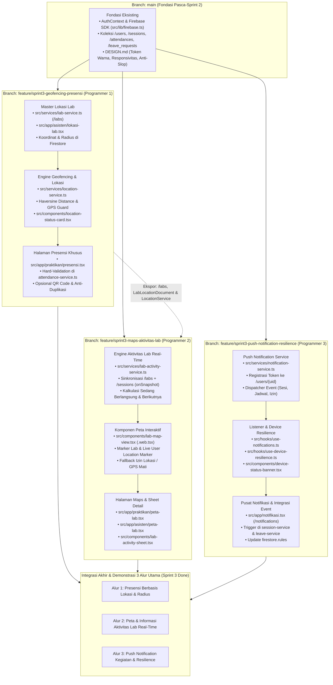

# SRS — Software Requirements Specification (Sprint 3)
## Presensi Berbasis Lokasi (Geofencing), Peta Laboratorium Interaktif, dan Push Notification

**Nama Aplikasi:** PPK LabPortal — Sistem Presensi, Pengelolaan Sesi & Moderasi Izin Praktikum  
**Institusi:** Departemen Informatika, Fakultas Sains dan Matematika, Universitas Diponegoro (UNDIP)  
**Mata Kuliah / Praktikum:** Praktikum Pengembangan Platform Khusus (PPK)  
**Fokus Pengembangan:** Integrasi fitur perangkat mobile (*device capabilities*) pada ekosistem React Native + Expo SDK 57 berupa validasi lokasi fisik (*geofencing*) pada halaman presensi khusus, pemetaan interaktif lokasi laboratorium Informatika beserta aktivitas praktikum real-time, serta sistem *push notification* berbasis peristiwa dengan penanganan izin dan kondisi perangkat yang tangguh.  
**Platform Target:** Android (Development Build & Production Build), iOS, dan Web Browser modern (dengan fallback terukur).  
**Strategi Kolaborasi:** Pembagian kerja paralel menjadi 3 sub-tim pengembang independen (**Programmer 1**, **Programmer 2**, dan **Programmer 3**) dengan branch Git terpisah berformat `feature/sprint3-*`.

---

## 1. Pendahuluan & Ringkasan Perubahan Arsitektur

### 1.1 Latar Belakang Masalah
Pada Sprint 2, aplikasi PPK LabPortal telah berhasil mengintegrasikan Firebase Authentication, Cloud Firestore real-time, pengelolaan sesi, pencatatan presensi anti-duplikasi, serta modul pengajuan dan moderasi izin berbantuan Model AI EDOM on-device. Namun, dari sisi operasional praktikum di lingkungan laboratorium fisik, masih terdapat beberapa celah utama:
1. **Presensi Belum Tervalidasi Secara Spasial:** Praktikan masih dapat melakukan presensi dari mana saja selama sesi berstatus `dibuka` dan mengetahui kode sesi 4 digit, karena sistem belum memeriksa keberadaan fisik pengguna di dalam radius laboratorium.
2. **Halaman Presensi Masih Menyatu dengan Detail Sesi:** Alur presensi belum dipisahkan ke halaman khusus yang berfokus pada pemeriksaan lokasi, status sesi, serta opsi verifikasi tambahan (seperti QR Code).
3. **Belum Ada Peta Persebaran & Status Aktivitas Laboratorium:** Mahasiswa dan asisten belum dapat memantau letak fisik ruang-ruang laboratorium Informatika secara visual pada peta, posisi diri relatif terhadap laboratorium, maupun praktikum apa yang sedang berlangsung dan akan berlangsung berikutnya di setiap ruangan.
4. **Keterlambatan Informasi (Passive Polling):** Pengguna harus membuka aplikasi secara manual untuk mengetahui saat sesi praktikum dibuka, saat jadwal mengalami perubahan, atau saat pengajuan izin disetujui/ditolak oleh asisten.
5. **Penanganan Kondisi Perangkat Belum Terstandarisasi:** Pemanfaatan GPS dan notifikasi berisiko menimbulkan error jika izin akses ditolak, layanan lokasi dimatikan, sinyal GPS belum terkunci, koneksi terputus, atau notifikasi tidak dapat diterima.

### 1.2 Tujuan Sprint 3
Sprint 3 memperluas PPK LabPortal menjadi aplikasi mobile *location-aware* dan *event-driven* yang:
1. Menyediakan **halaman presensi khusus** yang terpisah dari halaman detail sesi (dengan dukungan opsional pemindaian QR Code).
2. Menerapkan **validasi lokasi presensi (*geofencing*)** berbasis koordinat perangkat dan radius laboratorium yang tersimpan di Cloud Firestore, sehingga presensi di luar radius atau saat sesi tidak dibuka ditolak di level logika pencatatan (bukan sekadar tampilan visual).
3. Menyediakan modul **pengelolaan lokasi laboratorium** di Firestore agar asisten dapat mengatur koordinat dan radius masing-masing laboratorium.
4. Menghadirkan **halaman Maps interaktif** yang menampilkan marker seluruh laboratorium Informatika, marker posisi pengguna yang diperbarui secara langsung (*live tracking*), serta panel informasi praktikum yang sedang berlangsung dan praktikum berikutnya dari Firestore secara real-time.
5. Mengintegrasikan **push notification** berbasis peristiwa (sesi dibuka, perubahan jadwal, keputusan izin) yang dikirim tepat sasaran kepada pengguna yang berkepentingan.
6. Menjamin **ketahanan izin & kondisi perangkat** (*permission & device resilience*) melalui pesan informatif dan fallback yang jelas ketika izin ditolak, GPS nonaktif, lokasi belum tersedia, jaringan terganggu, atau notifikasi tidak dapat diterima.

### 1.3 Kepatuhan Desain Mutlak (Mandatory Compliance to `DESIGN.md`)
Setiap pengembang (**Programmer 1, Programmer 2, dan Programmer 3**) maupun asisten AI (*AI coding agent* seperti Copilot, Claude, Gemini, ChatGPT) yang mengimplementasikan kode pada Sprint 3 **WAJIB MENGIKUTI DAN MEMATUHI PANDUAN RESMI DI `DESIGN.md`**.  
Tujuan aturan ini adalah mencegah rusaknya konsistensi antarmuka (*UI breakage / visual slop*):
1. **Identitas Warna Peran:**
   - **Portal Praktikan:** Dominan aksen **Terracotta Orange** (`#EA580C`, tint `#FFF7ED`, border `#FED7AA`).
   - **Portal Asisten:** Dominan aksen **Academic Teal** (`#0D9488`, tint `#F0FDFA`, border `#99F6E4`).
   - **Kanvas & Permukaan:** Canvas netral **Slate Light** (`#F8FAFC`), permukaan kartu `#FFFFFF`, border halus `#E2E8F0`.
   - **Warna Semantik Status Lokasi & Notifikasi:**
     - Valid / Dalam Radius / Disetujui: Hijau (`#16A34A`, latar `#DCFCE7`).
     - Peringatan / Menunggu / GPS Lemah: Kuning/Amber (`#D97706`, latar `#FEF3C7`).
     - Gagal / Di Luar Radius / Izin Ditolak / Offline: Merah (`#DC2626`, latar `#FEE2E2`).
     - Informasi / Sesi Berikutnya: Biru (`#2563EB`, latar `#DBEAFE`).
2. **Aturan Anti-Slop (Zero Generic Emojis):**
   - **DILARANG KERAS** menggunakan icon emoji generik di dalam UI, tombol, chip status, marker label, banner error, teks modal, maupun isi notifikasi UI.
   - Gunakan simbol geometris rapi (`●`, `←`, `→`, `▲`, `▼`), inisial bulat (*avatar circle*), ikon vektor/komponen terstandarisasi, atau teks semantik tegas.
3. **Standar Responsivitas & Flexbox:**
   - Seluruh layar baru (Halaman Presensi, Pengelolaan Lokasi Lab, Peta Lab, Pusat Notifikasi) wajib memiliki pembatas lebar konten desktop: `maxWidth: 960px` terpusat (`alignSelf: 'center'`).
   - Padding adaptif: `paddingHorizontal: Platform.OS === 'web' ? 20 : 14`.
4. **Token Konsistensi Desain:**
   - Sudut melengkung seragam: `cardRadius: 14`, `buttonRadius: 10`, `pillRadius: 20`, `modalRadius: 20`.
   - Area sentuh minimal: `minHeight: 44` untuk kenyamanan pengguna perangkat mobile.

---

## 2. Arsitektur Sistem & Ekosistem Teknologi

```
+----------------------------------------------------------------------------------------+
|                                     CLIENT LAYER                                       |
|                         React Native + Expo SDK 57 (Expo Router)                       |
|                                                                                        |
|  +----------------------------------+   +-------------------------------------------+  |
|  |         PORTAL PRAKTIKAN         |   |            PORTAL ASISTEN LAB             |  |
|  | - Jadwal & Detail Sesi           |   | - CRUD Sesi & Roster Real-Time            |  |
|  | - Halaman Presensi Khusus (NEW)  |   | - Pengelolaan Lokasi & Radius Lab (NEW)   |  |
|  |   (Geofencing + Opsional QR)     |   | - Peta Lab Interaktif & Aktivitas (NEW)   |  |
|  | - Peta Lab Interaktif (NEW)      |   | - Moderasi Izin (AI EDOM) & Rekap         |  |
|  | - Pengajuan Izin & Riwayat       |   | - Pemicu Push Notification (NEW)          |  |
|  | - Pusat Notifikasi (NEW)         |   | - Pusat Notifikasi (NEW)                  |  |
|  +-----------------+----------------+   +---------------------+---------------------+  |
|                    |                                          |                        |
|                    +--------------------+---------------------+                        |
|                                         |                                              |
|         +-------------------------------v-------------------------------+              |
|         |               APPLICATION STATE, SERVICES & HOOKS             |              |
|         | - AuthContext (Firebase Auth + Push Token Sync)               |              |
|         | - LocationService (expo-location + Haversine Geofencing)      |              |
|         | - LabService & LabActivityService (onSnapshot /labs+/sessions)|              |
|         | - NotificationService (expo-notifications + Event Dispatcher) |              |
|         | - DeviceResilienceHook (Permissions, GPS, Network Guard)      |              |
|         +------------+---------------------------+----------------------+              |
+----------------------|---------------------------|-------------------------------------+
                       |                           |
          +------------+------------+              +------------------------+
          v                         v                                       v
+-------------------------+ +-------------------------+   +-----------------------------+
|    DEVICE CAPABILITIES  | |    FIREBASE BACKEND     |   |   PUSH NOTIFICATION LAYER   |
|                         | |                         |   |                             |
| 1. GPS / Geolocation    | | 1. Firebase Auth        |   | - Expo Push Service / FCM   |
|    - expo-location      | | 2. Cloud Firestore:     |   | - Event-Driven Delivery:    |
|    - Foreground Watch   | |    * /users (+tokens)   |   |   * Sesi Dibuka             |
| 2. Maps Rendering       | |    * /labs (NEW)        |   |   * Jadwal Diubah           |
|    - react-native-maps  | |    * /sessions (+labId) |   |   * Izin Disetujui/Ditolak  |
|    - Web Fallback Map   | |    * /attendances (+geo)|   | - In-App Notification Log   |
| 3. Camera (Opsional QR) | |    * /leave_requests    |   |   (Fallback jika push off)  |
|    - expo-camera        | |    * /notifications(NEW)|   +-----------------------------+
+-------------------------+ | 3. Security Rules RBAC  |
                            +-------------------------+
```

### Paket Expo / Library Tambahan yang Direkomendasikan (Install via `npx expo install`)
- `expo-location` — Akses izin lokasi, pengecekan status GPS, pengambilan koordinat akurat, dan pemantauan lokasi langsung (`watchPositionAsync`).
- `react-native-maps` — Peta interaktif native Android/iOS dengan marker laboratorium, lingkaran radius (opsional), dan marker posisi pengguna.
- `expo-notifications` — Permintaan izin notifikasi, pengambilan Expo Push Token / FCM device token, listener foreground/background, dan notifikasi lokal/push.
- `expo-camera` *(Opsional)* — Pemindaian QR Code pada halaman presensi jika kelompok mengaktifkan fitur QR Code.
- `@react-native-community/netinfo` *(atau cek konektivitas standar)* — Deteksi gangguan koneksi jaringan secara reaktif.

> [!NOTE]
> Karena `react-native-maps`, `expo-location`, `expo-notifications`, dan `@react-native-google-signin/google-signin` menyertakan modul native, pengujian penuh di perangkat fisik dilakukan melalui **Development Build** (`npx expo run:android` / `eas build --profile development`).

---

## 3. Skema Data Cloud Firestore (Single Source of Truth)

Sprint 3 mempertahankan seluruh koleksi Sprint 2 secara *backward-compatible* dan menambahkan koleksi `/labs` serta `/notifications` beserta beberapa field opsional tambahan.

### 3.1 Koleksi Baru `labs` (`/labs/{labId}`)
Menyimpan data master lokasi laboratorium Informatika beserta koordinat dan radius validasi presensi:
```typescript
export interface LabLocationDocument {
  id: string;               // Document ID (mis. 'lab-komputasi-1', 'lab-jaringan', dll.)
  nama: string;             // Nama resmi lab (mis. 'Lab Komputasi 1', 'Lab Rekayasa Perangkat Lunak')
  kode: string;             // Kode singkat lab (mis. 'LAB-K1', 'LAB-RPL')
  gedung: string;           // Lokasi gedung (mis. 'Gedung E Lantai 2, FSM UNDIP')
  latitude: number;         // Koordinat lintang (mis. -7.049123)
  longitude: number;        // Koordinat bujur (mis. 110.440123)
  radiusMeter: number;      // Radius validasi presensi dalam meter (default: 50, rentang 15-500)
  deskripsi?: string;       // Keterangan fasilitas/kapasitas lab
  isActive: boolean;        // Status operasional lab
  updatedBy: string;        // UID asisten terakhir yang mengubah
  createdAt: string;        // ISO 8601 Timestamp
  updatedAt: string;        // ISO 8601 Timestamp
}
```

### 3.2 Pembaruan Koleksi `sessions` (`/sessions/{sessionId}`)
Menambahkan relasi ke dokumen laboratorium agar validasi geofencing dan informasi aktivitas pada peta selalu konsisten:
```typescript
export interface SessionDocument {
  // ... seluruh field Sprint 2 tetap dipertahankan (id, praktikum, kelas, materi, tanggal,
  // waktuMulai, waktuSelesai, ruang, status, kodeSesi, createdBy, openedAt, closedAt, createdAt, updatedAt)

  labId?: string;           // Relasi ke /labs/{labId} (sumber koordinat & radius acuan)
  radiusOverride?: number;  // Opsional: radius khusus untuk sesi tertentu (meter)
  qrPayload?: string;       // Opsional: payload QR Code terenkode untuk sesi aktif
}
```

### 3.3 Pembaruan Koleksi `attendances` (`/attendances/{attendanceId}`)
Menyimpan bukti verifikasi lokasi fisik pada setiap catatan presensi yang sah (ID tetap `${sessionId}_${studentId}` untuk anti-duplikasi):
```typescript
export interface AttendanceDocument {
  // ... seluruh field Sprint 2 tetap dipertahankan

  verifiedByLocation: boolean; // Wajib true agar presensi tercatat sah
  verificationMethod: 'code-location' | 'qr-location'; // Metode verifikasi yang digunakan
  locationSnapshot?: {
    latitude: number;          // Koordinat praktikan saat presensi
    longitude: number;         // Koordinat praktikan saat presensi
    accuracy?: number;         // Akurasi GPS dalam meter
    distanceMeters: number;    // Jarak terhitung ke titik pusat laboratorium
    allowedRadiusMeters: number; // Radius maksimal yang berlaku saat presensi
    labId: string;             // ID lab acuan
    labName: string;           // Denormalisasi nama lab
    checkedAt: string;         // ISO timestamp pemeriksaan lokasi
  };
}
```

### 3.4 Pembaruan Koleksi `users` (`/users/{uid}`)
Menambahkan penyimpanan push token perangkat untuk pengiriman *push notification*:
```typescript
export interface UserDocument {
  // ... seluruh field Sprint 2 tetap dipertahankan

  expoPushToken?: string;      // Expo Push Token / FCM Token perangkat terbaru
  pushTokenUpdatedAt?: string; // ISO timestamp pembaruan token
  notificationsEnabled?: boolean; // Status preferensi / izin notifikasi terakhir
}
```

### 3.5 Koleksi Baru `notifications` (`/notifications/{notificationId}`)
Menyimpan log notifikasi berbasis peristiwa agar tetap teraudit dan dapat dilihat pengguna pada halaman Pusat Notifikasi (sekaligus fallback saat perangkat sedang offline atau izin push ditolak):
```typescript
export type NotificationEventType =
  | 'session_opened'
  | 'schedule_updated'
  | 'leave_approved'
  | 'leave_rejected';

export interface NotificationDocument {
  id: string;
  targetUserId: string;        // UID penerima (atau target kelas via fan-out per praktikan)
  targetRole: 'praktikan' | 'asisten';
  eventType: NotificationEventType;
  title: string;               // Judul pemberitahuan (tanpa emoji generik)
  body: string;                // Isi ringkas pemberitahuan
  relatedSessionId?: string;   // Referensi sesi terkait untuk navigasi/deep link
  relatedLeaveId?: string;     // Referensi izin terkait
  isRead: boolean;             // Status sudah dibaca di dalam aplikasi
  deliveryStatus: 'sent' | 'failed' | 'in_app_only';
  createdAt: string;           // ISO 8601 Timestamp
}
```

---

## 4. Matriks Pembagian Tanggung Jawab Tim & Alur Kerja (3 Programmer)

Agar pengerjaan Sprint 3 oleh 3 programmer berjalan paralel, modular, dan terhindar dari konflik kode (*zero merge conflicts*), arsitektur dibagi menjadi 3 domain independen:



### 4.1 Tabel Matriks Pembagian Tugas Lengkap

| No | Modul / Fitur | Programmer | Branch Git | Berkas yang Dimiliki / Diubah | Spesifikasi Logika Kunci | Kriteria Lolos (Definition of Done) |
|---|---|---|---|---|---|---|
| 1 | **Pengelolaan Lokasi Laboratorium (Firestore `/labs`)** | **Programmer 1** | `feature/sprint3-geofencing-presensi` | - `src/types/praktikum.ts`<br>- `src/services/lab-service.ts`<br>- `src/app/asisten/lokasi-lab.tsx` | • CRUD lokasi lab (nama, kode, gedung, lat, lng, radiusMeter) di Firestore `/labs`.<br>• Seed awal koordinat lab Informatika UNDIP.<br>• Penautan `labId` saat asisten membuat/mengedit sesi. | Asisten dapat menambah/mengubah koordinat & radius lab di Firestore dan langsung tersinkronisasi ke seluruh pengguna. |
| 2 | **Engine Lokasi & Validasi Radius (Geofencing)** | **Programmer 1** | `feature/sprint3-geofencing-presensi` | - `src/services/location-service.ts`<br>- `src/components/location-status-card.tsx` | • Request izin `expo-location`, cek GPS aktif, ambil posisi akurat.<br>• Hitung jarak Haversine (meter) antara posisi pengguna & koordinat lab.<br>• Penanganan izin ditolak, GPS mati, lokasi timeout. | Jarak terhitung akurat dalam meter; status `dalam-radius` vs `luar-radius` vs `error` tampil jelas tanpa crash. |
| 3 | **Halaman Presensi Khusus & Hard-Validation** | **Programmer 1** | `feature/sprint3-geofencing-presensi` | - `src/app/praktikan/presensi.tsx`<br>- `src/services/attendance-service.ts` | • Halaman khusus terpisah dari `detail-sesi/[id].tsx`.<br>• Validasi wajib di service: sesi harus `dibuka`, kelas cocok, kode/QR valid, dalam radius lab, dan anti-duplikasi `${sessionId}_${studentId}`.<br>• Opsional: QR Code generator (asisten) & scanner (praktikan). | Presensi ditolak di level service jika di luar radius/sesi tutup/duplikat; jika valid, tersimpan lengkap dengan `locationSnapshot` dan muncul di rekap asisten. |
| 4 | **Service Aktivitas Laboratorium Real-Time** | **Programmer 2** | `feature/sprint3-maps-aktivitas-lab` | - `src/services/lab-activity-service.ts` | • Menggabungkan listener `onSnapshot` koleksi `/labs` dan `/sessions`.<br>• Menentukan `ongoingSession` (status `dibuka` atau jam berjalan) dan `nextSession` (jadwal terdekat berikutnya) per lab. | Perubahan jadwal atau status sesi oleh asisten langsung memperbarui data aktivitas lab tanpa reload. |
| 5 | **Peta Laboratorium Interaktif & Live User Tracking** | **Programmer 2** | `feature/sprint3-maps-aktivitas-lab` | - `src/components/lab-map-view.tsx`<br>- `src/components/lab-map-view.web.tsx` | • Menampilkan marker seluruh lab Informatika (`react-native-maps`).<br>• Marker lokasi pengguna live via `watchPositionAsync` selama halaman aktif (berhenti saat unmount).<br>• Fallback ramah pengguna untuk Web dan kondisi GPS/izin ditolak. | Peta menampilkan marker lab & posisi pengguna yang bergerak mengikuti perangkat; tidak crash jika izin ditolak atau di Web. |
| 6 | **Halaman Maps & Panel Detail Aktivitas Lab** | **Programmer 2** | `feature/sprint3-maps-aktivitas-lab` | - `src/app/praktikan/peta-lab.tsx`<br>- `src/app/asisten/peta-lab.tsx`<br>- `src/components/lab-activity-sheet.tsx` | • Klik marker membuka panel info lab: nama lab, radius, jarak pengguna, praktikum sedang berlangsung, dan praktikum berikutnya (nama praktikum, kelas, waktu, status sesi).<br>• Tombol pintasan langsung ke halaman presensi (untuk praktikan) atau detail sesi. | Memilih marker lab menampilkan informasi lengkap praktikum berlangsung & berikutnya sesuai data Firestore terbaru. |
| 7 | **Push Notification Service & Token Management** | **Programmer 3** | `feature/sprint3-push-notification-resilience` | - `src/services/notification-service.ts`<br>- `src/hooks/use-notifications.ts` | • Minta izin `expo-notifications`, ambil Expo Push Token / FCM token, simpan ke `/users/{uid}`.<br>• Fungsi dispatcher notifikasi ke pengguna target via Expo Push API / FCM + simpan log ke `/notifications`.<br>• Penanganan tap notifikasi (navigasi ke halaman terkait). | Token tersimpan di Firestore; notifikasi terkirim ke perangkat pengguna yang berkepentingan saat event terjadi. |
| 8 | **Integrasi Event Trigger Notifikasi** | **Programmer 3** | `feature/sprint3-push-notification-resilience` | - `src/services/session-service.ts`<br>- `src/services/leave-service.ts`<br>- `src/app/notifikasi.tsx` | • Trigger 1: Asisten membuka sesi → notif ke praktikan kelas terkait.<br>• Trigger 2: Asisten mengubah jadwal sesi → notif ke praktikan kelas terkait.<br>• Trigger 3: Asisten menyetujui/menolak izin → notif ke praktikan pemohon.<br>• Layar Pusat Notifikasi in-app sebagai riwayat & fallback. | Ketiga peristiwa memicu pengiriman push notification tepat sasaran dan tercatat di Pusat Notifikasi. |
| 9 | **Penanganan Izin, Kondisi Perangkat & Security Rules** | **Programmer 3** | `feature/sprint3-push-notification-resilience` | - `src/hooks/use-device-resilience.ts`<br>- `src/components/device-status-banner.tsx`<br>- `firestore.rules` | • Deteksi terpadu: koneksi offline, izin lokasi ditolak, layanan GPS nonaktif, izin notifikasi ditolak, kegagalan pengiriman notifikasi.<br>• Komponen `DeviceStatusBanner` reusable dengan aksi "Buka Pengaturan" / "Coba Lagi".<br>• Perbarui `firestore.rules` untuk koleksi `/labs` dan `/notifications`. | Aplikasi tidak crash pada semua kondisi error perangkat; pesan panduan tampil jelas sesuai `DESIGN.md` dan rules teruji. |

### 4.2 Kontrak Antarmuka Dependensi (Interface Contract)
Untuk memastikan ketiga programmer dapat bekerja secara paralel tanpa saling menunggu:
1. **Kontrak Data Koleksi `/labs` (Disediakan Programmer 1, Dikonsumsi Programmer 2):**
   - Nama koleksi Firestore wajib: `labs`.
   - Field minimal yang wajib konsisten: `id`, `nama`, `kode`, `gedung`, `latitude`, `longitude`, `radiusMeter`, `isActive`.
   - Relasi pada `/sessions`: field opsional `labId` (dan fallback pencocokan berdasarkan field `ruang` agar sesi lama dari Sprint 2 tetap tampil pada peta).
2. **Kontrak Fungsi Lokasi (Disediakan Programmer 1, Dapat Digunakan Ulang Programmer 2):**
   - `calculateDistanceMeters(lat1, lon1, lat2, lon2): number` (rumus Haversine murni).
   - `checkLocationReadiness()` mengembalikan status terstruktur: `'ready' | 'permission_denied' | 'services_disabled' | 'unavailable'`.
3. **Kontrak Komponen Resilience & Event Trigger (Disediakan Programmer 3, Dapat Dipasang di Layar P1 & P2):**
   - `<DeviceStatusBanner />` menerima props `type: 'offline' | 'location_denied' | 'gps_off' | 'notification_denied' | 'location_unavailable'` dan callback `onRetry?`.
   - Fungsi trigger notifikasi bersifat *non-blocking* (`try/catch` internal) sehingga kegagalan jaringan push API **tidak pernah menggagalkan** aksi utama asisten (buka sesi, ubah jadwal, atau moderasi izin).
4. **Kontrak Navigasi Tab (`_layout.tsx`):**
   - Setiap programmer membuat file layarnya terlebih dahulu di branch masing-masing (`presensi.tsx`, `lokasi-lab.tsx`, `peta-lab.tsx`, `notifikasi.tsx`).
   - Penambahan entry tab di `src/app/praktikan/_layout.tsx` dan `src/app/asisten/_layout.tsx` diselaraskan pada tahap integrasi agar minim konflik merge.

---

## 5. Rincian Kebutuhan Fungsional — Programmer 1
### (Branch: `feature/sprint3-geofencing-presensi`)

### FR-P1-01 — Pengelolaan Lokasi & Radius Laboratorium (`/labs`)
- **FR-P1-01.1:** Menyediakan layanan `src/services/lab-service.ts` untuk operasi CRUD koleksi Firestore `/labs` (`subscribeLabs`, `getLabById`, `createLab`, `updateLab`, `deleteLab`, dan `seedDefaultLabsIfEmpty` berisi koordinat awal laboratorium Informatika UNDIP).
- **FR-P1-01.2:** Menyediakan halaman pengelolaan lokasi laboratorium bagi asisten (`src/app/asisten/lokasi-lab.tsx`) untuk menambah, mengedit, dan mengatur:
  - Nama & Kode Laboratorium, Gedung.
  - Koordinat `latitude` dan `longitude` (termasuk tombol *"Gunakan Lokasi Saya Saat Ini"* untuk memudahkan asisten mengambil koordinat langsung di ruang lab).
  - Radius validasi presensi dalam meter (validasi rentang aman, misal `15m` – `500m`, default `50m`).
- **FR-P1-01.3:** Menautkan pilihan laboratorium (`labId`) saat asisten membuat atau mengubah sesi praktikum sehingga setiap sesi terhubung ke acuan koordinat dan radius yang jelas.

### FR-P1-02 — Layanan Lokasi Perangkat & Perhitungan Geofencing
- **FR-P1-02.1:** Membangun `src/services/location-service.ts` berbasis `expo-location` dengan fungsi:
  - Meminta izin lokasi foreground (`requestForegroundPermissionsAsync`).
  - Memeriksa apakah layanan lokasi / GPS perangkat aktif (`hasServicesEnabledAsync`).
  - Mengambil koordinat perangkat terbaru dengan akurasi tinggi (`getCurrentPositionAsync`) disertai batas waktu (*timeout*) agar tidak menggantung.
  - Menghitung jarak akurat dalam meter menggunakan rumus **Haversine** (`calculateDistanceMeters`).
- **FR-P1-02.2:** Mengembalikan hasil pemeriksaan lokasi terstruktur (`LocationVerificationResult`):
  - Status: `'within_radius' | 'outside_radius' | 'permission_denied' | 'services_disabled' | 'unavailable'`.
  - Jarak aktual dalam meter, radius yang diizinkan, koordinat pengguna, akurasi GPS, dan pesan penjelasan ramah pengguna.

### FR-P1-03 — Halaman Presensi Khusus (Terpisah dari Detail Sesi)
- **FR-P1-03.1:** Menyediakan halaman khusus presensi di `src/app/praktikan/presensi.tsx` yang terpisah dari `src/app/praktikan/detail-sesi/[id].tsx` (dapat diakses dari tab/navigasi praktikan maupun tombol *"Buka Halaman Presensi"* pada kartu/detail sesi).
- **FR-P1-03.2:** Menampilkan informasi sesi yang akan diikuti: nama praktikum, materi, kelas, ruang/laboratorium, jadwal waktu, dan badge status sesi (`Belum Dibuka` / `Dibuka` / `Ditutup`).
- **FR-P1-03.3:** Menampilkan komponen `LocationStatusCard` (`src/components/location-status-card.tsx`) yang memuat hasil pemeriksaan lokasi secara eksplisit:
  - Jarak pengguna terhadap laboratorium (mis. `18 meter dari Lab Komputasi 1 • Batas radius: 50 meter`).
  - Indikator visual status: **Di Dalam Radius** (Hijau), **Di Luar Radius** (Merah), atau **Lokasi Tidak Tersedia / Izin Ditolak / GPS Nonaktif** (Amber/Merah) beserta tombol *"Periksa Ulang Lokasi"* dan *"Buka Pengaturan"*.
- **FR-P1-03.4 (Opsional — QR Code Presensi):** Asisten dapat menampilkan QR Code sesi aktif yang memuat payload terverifikasi (`sessionId` + `kodeSesi`), dan praktikan dapat memindainya dari halaman presensi sebagai alternatif pengisian manual kode 4 digit — namun tetap wajib lolos validasi lokasi dan radius.

### FR-P1-04 — Validasi Keras (Hard Enforcement) Pencatatan Presensi & Anti-Duplikasi
- **FR-P1-04.1:** Validasi lokasi **WAJIB** dieksekusi ulang di dalam fungsi pencatatan presensi pada `src/services/attendance-service.ts`, bukan hanya menonaktifkan tombol pada UI.
- **FR-P1-04.2:** Syarat mutlak agar dokumen presensi boleh ditulis ke Firestore `/attendances/{sessionId}_${studentId}`:
  1. Sesi berstatus `dibuka` di Firestore.
  2. Kelas praktikan sesuai dengan kelas sesi.
  3. Kode sesi 4 digit (atau payload QR) cocok dengan `kodeSesi` sesi aktif.
  4. Lokasi perangkat berhasil diperoleh dan jarak terhitung `<= allowedRadiusMeters`.
  5. Dokumen `${sessionId}_${studentId}` belum ada di Firestore (proteksi anti-duplikasi).
- **FR-P1-04.3:** Apabila salah satu syarat gagal, proses penulisan dibatalkan dan sistem mengembalikan pesan galat spesifik. Apabila seluruh syarat terpenuhi, dokumen presensi disimpan lengkap dengan `verifiedByLocation: true` dan objek `locationSnapshot` sehingga langsung muncul di rekap kehadiran asisten.

---

## 6. Rincian Kebutuhan Fungsional — Programmer 2
### (Branch: `feature/sprint3-maps-aktivitas-lab`)

### FR-P2-01 — Peta Laboratorium Interaktif (Halaman Maps)
- **FR-P2-01.1:** Menyediakan halaman Maps yang dapat diakses baik dari portal Praktikan (`src/app/praktikan/peta-lab.tsx`) maupun portal Asisten (`src/app/asisten/peta-lab.tsx`).
- **FR-P2-01.2:** Menampilkan peta interaktif (`src/components/lab-map-view.tsx`) berpusat di kawasan Departemen Informatika FSM UNDIP dengan marker untuk setiap laboratorium aktif dari koleksi Firestore `/labs`.
- **FR-P2-01.3:** Marker laboratorium memiliki pembeda visual yang jelas (sesuai `DESIGN.md`, tanpa emoji generik) untuk menandakan apakah di laboratorium tersebut sedang ada praktikum berlangsung atau tidak, serta menampilkan lingkaran area radius laboratorium ketika marker dipilih.
- **FR-P2-01.4:** Menyediakan implementasi fallback untuk Web (`src/components/lab-map-view.web.tsx`) agar aplikasi tetap dapat dirender dan diuji di browser tanpa error kompatibilitas native.

### FR-P2-02 — Pemantauan Lokasi Pengguna Secara Langsung (*Live User Marker*)
- **FR-P2-02.1:** Saat halaman Maps dibuka dan izin lokasi diberikan, aplikasi mengaktifkan pemantauan posisi perangkat menggunakan `Location.watchPositionAsync` (dengan interval jarak/waktu yang hemat baterai, mis. `distanceInterval: 5`, `timeInterval: 3000`).
- **FR-P2-02.2:** Marker posisi pengguna pada peta bergerak mengikuti perubahan koordinat perangkat selama halaman Maps digunakan, dan tombol *"Pusatkan ke Lokasi Saya"* tersedia untuk mengembalikan kamera peta ke posisi pengguna.
- **FR-P2-02.3:** Subscription lokasi **wajib dibersihkan (*cleanup/remove*)** saat pengguna meninggalkan halaman Maps untuk mencegah kebocoran memori dan pengurasan baterai.
- **FR-P2-02.4:** Apabila izin lokasi ditolak, GPS mati, atau lokasi belum tersedia, peta **tetap menampilkan seluruh marker laboratorium**, disertai banner informasi yang jelas tanpa menutup akses peta.

### FR-P2-03 — Informasi Aktivitas Laboratorium Real-Time dari Firestore
- **FR-P2-03.1:** Membangun `src/services/lab-activity-service.ts` yang menyinkronkan koleksi `/labs` dan `/sessions` melalui `onSnapshot` Firestore secara real-time.
- **FR-P2-03.2:** Untuk setiap laboratorium, sistem menghitung secara otomatis:
  - **Praktikum Sedang Berlangsung (`ongoingSession`):** Sesi yang terhubung ke laboratorium tersebut dan sedang berstatus `dibuka` (atau berada dalam rentang waktu pelaksanaan hari ini dan belum ditutup).
  - **Praktikum Berikutnya (`nextSession`):** Sesi terdekat berikutnya pada laboratorium tersebut yang berstatus `belum-dibuka`.
- **FR-P2-03.3:** Ketika pengguna mengetuk/memilih sebuah marker laboratorium, panel detail (`src/components/lab-activity-sheet.tsx`) menampilkan:
  - Nama laboratorium, kode, gedung, radius presensi, dan jarak dari posisi pengguna (jika lokasi tersedia).
  - Kartu **Praktikum Sedang Berlangsung**: nama praktikum, kelas, materi, waktu pelaksanaan (`waktuMulai - waktuSelesai`), serta badge status sesi (`Dibuka` / `Tidak Ada Sesi Aktif`).
  - Kartu **Praktikum Berikutnya**: nama praktikum, kelas, tanggal, waktu pelaksanaan, dan status sesi (`Belum Dibuka`).
  - Tombol aksi cepat: *"Buka Halaman Presensi"* (khusus praktikan jika ada sesi `dibuka` yang sesuai kelasnya) atau *"Lihat Detail Sesi"*.
- **FR-P2-03.4:** Setiap perubahan jadwal atau perubahan status sesi (`belum-dibuka` → `dibuka` → `ditutup`) oleh asisten di Firestore harus langsung tercermin pada panel informasi laboratorium tanpa perlu memuat ulang halaman.

---

## 7. Rincian Kebutuhan Fungsional — Programmer 3
### (Branch: `feature/sprint3-push-notification-resilience`)

### FR-P3-01 — Infrastruktur Push Notification & Manajemen Token Perangkat
- **FR-P3-01.1:** Membangun `src/services/notification-service.ts` menggunakan `expo-notifications` untuk:
  - Mengonfigurasi *notification handler* foreground (menampilkan alert/banner & suara saat aplikasi sedang dibuka) serta Android Notification Channel (`praktikum-updates`).
  - Meminta izin notifikasi secara kontekstual dan mengambil Expo Push Token / FCM token perangkat fisik (`getExpoPushTokenAsync`).
  - Menyimpan token ke dokumen pengguna di Firestore (`/users/{uid}` pada field `expoPushToken` dan `notificationsEnabled`) setiap kali pengguna login atau token berubah.
- **FR-P3-01.2:** Membangun hook `src/hooks/use-notifications.ts` yang menangani:
  - Listener notifikasi masuk saat aplikasi aktif (*foreground*).
  - Listener respons saat pengguna mengetuk notifikasi (*tap interaction*) untuk mengarahkan pengguna ke layar yang relevan (mis. halaman presensi saat sesi dibuka, jadwal saat jadwal diubah, atau riwayat izin saat izin diputuskan).

### FR-P3-02 — Pengiriman Notifikasi Berbasis Peristiwa (*Event-Driven*)
Sistem wajib mengirim push notification kepada pengguna yang berkepentingan pada 3 peristiwa utama:
- **FR-P3-02.1 (Peristiwa 1 — Sesi Praktikum Dibuka):**
  - Dipicu ketika asisten mengubah status sesi menjadi `dibuka` di `session-service.ts`.
  - Target penerima: seluruh praktikan pada kelas terkait (`users` dengan `peran == 'praktikan'` dan `kelas` sesuai sesi).
  - Konten: judul dan isi mencantumkan nama praktikum, kelas, ruang lab, dan ajakan melakukan presensi.
- **FR-P3-02.2 (Peristiwa 2 — Perubahan Jadwal Praktikum):**
  - Dipicu ketika asisten memperbarui tanggal, jam (`waktuMulai`/`waktuSelesai`), materi, atau ruang/lab suatu sesi.
  - Target penerima: seluruh praktikan pada kelas terkait.
  - Konten: mencantumkan nama praktikum dan ringkasan perubahan jadwal terbaru.
- **FR-P3-02.3 (Peristiwa 3 — Keputusan Pengajuan Izin):**
  - Dipicu ketika asisten menyetujui (`disetujui`) atau menolak (`ditolak`) pengajuan izin di `leave-service.ts`.
  - Target penerima: hanya praktikan pemohon izin tersebut (`leaveRequest.studentId`).
  - Konten: mencantumkan nama sesi, keputusan (`Izin Disetujui` / `Izin Ditolak`), serta ringkasan catatan asisten jika ada.
- **FR-P3-02.4 (Audit & Pusat Notifikasi In-App):**
  - Setiap notifikasi yang dipicu juga dicatat pada koleksi Firestore `/notifications` dan ditampilkan secara real-time di halaman `src/app/notifikasi.tsx` (lengkap dengan status baca/belum dibaca dan penanda jumlah notifikasi baru).

### FR-P3-03 — Penanganan Izin & Kondisi Perangkat (*Device & Network Resilience*)
- **FR-P3-03.1:** Membangun hook `src/hooks/use-device-resilience.ts` dan komponen `src/components/device-status-banner.tsx` untuk memantau dan menangani secara ramah seluruh kondisi tepi (*edge cases*):
  1. **Izin Lokasi Ditolak:** Menampilkan penjelasan mengapa izin lokasi diperlukan untuk presensi/peta + tombol pintasan ke Pengaturan Perangkat (`Linking.openSettings()`).
  2. **Layanan Lokasi (GPS) Nonaktif:** Menampilkan instruksi mengaktifkan GPS + tombol periksa ulang.
  3. **Lokasi Belum Tersedia / Timeout:** Menampilkan indikator pemuatan dan pesan gagal memperoleh koordinat dengan opsi coba lagi.
  4. **Izin Notifikasi Ditolak / Tidak Dapat Diterima (mis. emulator/perangkat tanpa token):** Menampilkan informasi bahwa notifikasi push tidak aktif dan mengarahkan pengguna bahwa pemberitahuan tetap dapat dipantau melalui halaman Pusat Notifikasi in-app.
  5. **Gangguan Koneksi Jaringan (Offline):** Menampilkan banner status koneksi terganggu tanpa membuat aplikasi crash dan menginformasikan bahwa aksi presensi/pengiriman notifikasi membutuhkan koneksi internet.
- **FR-P3-03.2:** Memperbarui `firestore.rules` agar mencakup aturan keamanan RBAC untuk koleksi baru:
  - `/labs/{labId}`: `read` untuk semua pengguna terautentikasi; `create`, `update`, `delete` hanya untuk peran `asisten`.
  - `/notifications/{notificationId}`: `read` dan `update` (khusus field `isRead`) untuk `targetUserId == request.auth.uid`; `create` untuk pengguna terautentikasi sesuai alur event.

---

## 8. Skenario Pengujian Alur Terintegrasi (End-to-End Evaluation)

Aplikasi wajib mampu mendemonstrasikan **3 alur utama** secara mulus, real-time, dan konsisten:

### Skenario 1: Presensi Berbasis Lokasi (*Geofencing*)
1. **Pengaturan Lab & Pembukaan Sesi (Asisten):**
   - Asisten membuka halaman Pengelolaan Lokasi Lab, memastikan koordinat dan radius (mis. `50 meter`) Lab Komputasi 1 tersimpan di Firestore.
   - Asisten membuka sesi praktikum yang tertaut ke Lab Komputasi 1 sehingga status menjadi `dibuka` dan kode 4 digit aktif.
2. **Uji Penolakan di Luar Radius (Praktikan):**
   - Praktikan membuka **Halaman Presensi Khusus** (terpisah dari detail sesi).
   - Apabila posisi praktikan berada di luar radius (mis. jarak `180 meter > 50 meter`), status lokasi menampilkan **Di Luar Radius** dan upaya submit presensi ditolak oleh sistem (tidak tertulis di Firestore).
3. **Uji Presensi Sah di Dalam Radius & Anti-Duplikasi (Praktikan → Asisten):**
   - Saat praktikan berada di dalam radius (mis. jarak `12 meter <= 50 meter`), status lokasi menampilkan **Di Dalam Radius**.
   - Praktikan memasukkan kode sesi 4 digit (atau memindai QR Code), lalu mengirim presensi.
   - Dokumen presensi tersimpan di `/attendances/${sessionId}_${studentId}` lengkap dengan `locationSnapshot`.
   - Percobaan presensi kedua pada sesi yang sama ditolak otomatis.
   - Layar rekap kehadiran asisten langsung menampilkan praktikan tersebut berstatus **Hadir** secara real-time.

### Skenario 2: Peta & Informasi Aktivitas Laboratorium
1. Pengguna (Praktikan atau Asisten) membuka halaman **Peta Laboratorium**.
2. Peta menampilkan seluruh marker laboratorium Informatika beserta marker posisi pengguna yang diperbarui mengikuti pergerakan perangkat.
3. Pengguna memilih salah satu marker laboratorium (mis. Lab Komputasi 1).
4. Panel detail menampilkan **Praktikum Sedang Berlangsung** dan **Praktikum Berikutnya** (nama praktikum, kelas, waktu, status sesi) berdasarkan data Firestore.
5. Ketika asisten mengubah status sesi atau mengedit jam jadwal di perangkat lain, informasi pada panel laboratorium langsung berubah secara real-time.

### Skenario 3: Push Notification Kegiatan & Ketahanan Kondisi Perangkat
1. **Sesi Dibuka / Jadwal Diubah:** Asisten membuka sesi atau mengubah jam/ruang jadwal → praktikan pada kelas terkait menerima push notification di perangkatnya dan melihat entri baru di Pusat Notifikasi.
2. **Keputusan Izin:** Asisten menyetujui atau menolak pengajuan izin seorang praktikan → hanya praktikan pemohon tersebut yang menerima push notification hasil keputusan.
3. **Uji Kondisi Perangkat:**
   - Izin lokasi ditolak / GPS dimatikan → aplikasi menampilkan pesan panduan jelas + tombol buka pengaturan (tidak crash).
   - Izin notifikasi ditolak → aplikasi memberi informasi status notifikasi nonaktif dan tetap menampilkan pemberitahuan di Pusat Notifikasi in-app.
   - Koneksi internet diputus → banner gangguan koneksi muncul dan aksi presensi dicegah dengan pesan yang jelas.

---

## 9. Panduan Teknis, Protokol Kolaborasi Git & Prompt 3 Programmer

### 9.1 Ringkasan Branch Git Sprint 3
Tiga branch independen telah disiapkan di repositori lokal dari titik `main` terbaru (`6e91fcd`):
1. **Programmer 1:** `feature/sprint3-geofencing-presensi`
2. **Programmer 2:** `feature/sprint3-maps-aktivitas-lab`
3. **Programmer 3:** `feature/sprint3-push-notification-resilience`

> [!IMPORTANT]
> **Aturan Git:**
> - Setiap programmer bekerja exclusivamente di branch masing-masing.
> - Gunakan `npx expo install <package>` (bukan `npm install`) saat menambah dependensi Expo seperti `expo-location`, `react-native-maps`, atau `expo-notifications`.
> - Wajib lulus `npx tsc --noEmit` dan `npx expo lint` sebelum commit atau merge ke `main`.

### 9.2 Urutan Penggabungan (*Merge Protocol*)
1. **Tahap 1:** Programmer 1 menyelesaikan dan memverifikasi `feature/sprint3-geofencing-presensi` (karena menyediakan kontrak tipe `/labs`, `lab-service.ts`, dan `location-service.ts`), lalu merge ke `main`.
2. **Tahap 2:** Programmer 2 (`feature/sprint3-maps-aktivitas-lab`) dan Programmer 3 (`feature/sprint3-push-notification-resilience`) melakukan `git merge main` ke branch masing-masing untuk menyinkronkan skema `/labs`, menautkan navigasi tab `_layout.tsx`, dan menguji integrasi end-to-end.
3. **Tahap 3:** Merge `feature/sprint3-maps-aktivitas-lab` lalu `feature/sprint3-push-notification-resilience` ke `main`, diikuti verifikasi 3 skenario demonstrasi utama.

---

### 9.3 Petunjuk Prompt Siap Pakai — Programmer 1
**Branch:** `feature/sprint3-geofencing-presensi`  
Salin prompt berikut untuk diberikan kepada Programmer 1 / AI Coding Agent:

````markdown
Halo AI Assistant, saya bertindak sebagai **Programmer 1 (Sprint 3)** pada proyek aplikasi mobile **PPK LabPortal** (React Native + Expo SDK 57, TypeScript, Expo Router, Firebase v13).
Saat ini saya bekerja di Git branch lokal: `feature/sprint3-geofencing-presensi`.
Rujuk spesifikasi lengkap di `SRS3.md` dan patuhi aturan UI di `DESIGN.md`.

Tolong bantu saya mengimplementasikan **Modul Pengelolaan Lokasi Laboratorium, Geofencing Presensi, dan Halaman Presensi Khusus**:

### 1. Spesifikasi Teknis & Berkas yang Dikerjakan:
1. Install dependensi SDK-compatible menggunakan `npx expo install expo-location` (dan `expo-camera` jika mengaktifkan fitur opsional QR Code).
2. `src/types/praktikum.ts`:
   - Tambahkan interface `LabLocationDocument` (koleksi `/labs`: `id`, `nama`, `kode`, `gedung`, `latitude`, `longitude`, `radiusMeter`, `deskripsi?`, `isActive`, `updatedBy`, `createdAt`, `updatedAt`) dan `LocationVerificationResult`.
   - Perluas `SessionDocument` dengan `labId?: string`, `radiusOverride?: number`, `qrPayload?: string`.
   - Perluas `AttendanceDocument` dengan `verifiedByLocation: boolean`, `verificationMethod: 'code-location' | 'qr-location'`, dan `locationSnapshot` (koordinat, akurasi, jarak, radius, labId, labName, checkedAt).
3. `src/services/lab-service.ts`:
   - Buat layanan CRUD koleksi Cloud Firestore `/labs` (`subscribeLabs`, `getLabById`, `createLab`, `updateLab`, `deleteLab`, dan `seedDefaultLabsIfEmpty` berisi koordinat awal laboratorium Informatika UNDIP).
4. `src/app/asisten/lokasi-lab.tsx`:
   - Halaman manajemen lokasi laboratorium bagi Asisten untuk melihat, menambah, dan mengubah koordinat (latitude, longitude) serta radius validasi (meter), termasuk tombol "Gunakan Lokasi Saya Saat Ini".
   - Integrasikan pemilihan `labId` pada form tambah/edit sesi asisten agar sesi terhubung dengan koordinat lab.
5. `src/services/location-service.ts`:
   - Implementasikan wrapper `expo-location` untuk meminta izin lokasi foreground, mengecek apakah GPS/layanan lokasi aktif, mengambil koordinat akurat dengan timeout, menghitung jarak Haversine (`calculateDistanceMeters`), dan mengevaluasi status lokasi (`within_radius`, `outside_radius`, `permission_denied`, `services_disabled`, `unavailable`).
6. `src/components/location-status-card.tsx`:
   - Komponen kartu status pemeriksaan lokasi yang menampilkan nama lab, jarak saat ini (meter), batas radius, status visual jelas, tombol "Periksa Ulang Lokasi", dan tombol "Buka Pengaturan" saat izin ditolak/GPS mati.
7. `src/app/praktikan/presensi.tsx` & `src/services/attendance-service.ts`:
   - Buat **Halaman Presensi Khusus** yang terpisah dari `src/app/praktikan/detail-sesi/[id].tsx`.
   - Tampilkan informasi sesi, status sesi, `LocationStatusCard`, input kode 4 digit (plus opsi QR Code jika diaktifkan), dan tombol kirim presensi.
   - **WAJIB Hard-Validation di `attendance-service.ts`:** Sebelum menulis ke `/attendances/${sessionId}_${studentId}`, validasi ulang bahwa sesi berstatus `dibuka`, kelas sesuai, kode/QR cocok, lokasi valid dan jarak `<= radius`, serta belum pernah presensi pada sesi tersebut (anti-duplikasi). Jika gagal, tolak pencatatan dengan pesan error jelas.

### 2. Standar Kepatuhan Desain Mutlak (`DESIGN.md`):
- **Warna:** Praktikan Terracotta Orange (`#EA580C`), Asisten Academic Teal (`#0D9488`), Canvas `#F8FAFC`, Kartu `#FFFFFF`, Border `#E2E8F0`. Status valid Hijau (`#16A34A`), Peringatan Amber (`#D97706`), Di luar radius/Error Merah (`#DC2626`).
- **Anti-Slop:** DILARANG KERAS menggunakan emoji generik di UI, tombol, badge, maupun alert. Gunakan simbol geometris (`●`, `←`, `→`) dan teks semantik tegas.
- **Layout:** Container desktop terpusat `maxWidth: 960`, `borderRadius: 14` (kartu), `borderRadius: 10` (tombol), `minHeight: 44`.

### 3. Verifikasi Wajib:
- Jalankan `npx tsc --noEmit` (0 error) dan `npx expo lint` (0 error).
- Jangan push ke remote sebelum integrasi lokal selesai.
````

---

### 9.4 Petunjuk Prompt Siap Pakai — Programmer 2
**Branch:** `feature/sprint3-maps-aktivitas-lab`  
Salin prompt berikut untuk diberikan kepada Programmer 2 / AI Coding Agent:

````markdown
Halo AI Assistant, saya bertindak sebagai **Programmer 2 (Sprint 3)** pada proyek aplikasi mobile **PPK LabPortal** (React Native + Expo SDK 57, TypeScript, Expo Router, Firebase v13).
Saat ini saya bekerja di Git branch lokal: `feature/sprint3-maps-aktivitas-lab`.
Rujuk spesifikasi lengkap di `SRS3.md` dan patuhi aturan UI di `DESIGN.md`.

Tolong bantu saya mengimplementasikan **Modul Peta Laboratorium Interaktif, Live User Tracking, dan Informasi Aktivitas Laboratorium Real-Time**:

### 1. Spesifikasi Teknis & Berkas yang Dikerjakan:
1. Install dependensi SDK-compatible menggunakan `npx expo install react-native-maps expo-location`.
2. `src/services/lab-activity-service.ts`:
   - Dengarkan koleksi Cloud Firestore `/labs` dan `/sessions` secara real-time menggunakan `onSnapshot`.
   - Sediakan fungsi pemetaan per laboratorium yang menghasilkan:
     - `ongoingSession`: praktikum yang sedang berlangsung pada lab tersebut (prioritas status `dibuka` atau sedang dalam rentang jam pelaksanaan).
     - `nextSession`: praktikum berikutnya yang berstatus `belum-dibuka` dan paling dekat waktunya.
   - Cocokkan sesi ke laboratorium berdasarkan `session.labId`, dengan fallback pencocokan nama `session.ruang` agar data sesi lama tetap kompatibel.
3. `src/components/lab-map-view.tsx` & `src/components/lab-map-view.web.tsx`:
   - Pada versi native (`lab-map-view.tsx`), gunakan `react-native-maps` (`MapView`, `Marker`, `Circle`) berpusat di area Departemen Informatika FSM UNDIP.
   - Tampilkan marker seluruh laboratorium dari Firestore (dengan warna berbeda jika sedang ada praktikum berlangsung vs tidak ada) dan lingkaran radius laboratorium ketika marker dipilih.
   - Tampilkan **marker lokasi pengguna secara live** menggunakan `Location.watchPositionAsync` selama halaman digunakan, dan pastikan listener dibersihkan saat unmount.
   - Sediakan tombol "Pusatkan ke Lokasi Saya" dan fallback aman jika izin lokasi ditolak / GPS mati (peta laboratorium tetap bisa dilihat dengan banner informasi jelas).
   - Pada versi web (`lab-map-view.web.tsx`), sediakan tampilan peta/daftar koordinat interaktif fallback agar web build tidak crash.
4. `src/components/lab-activity-sheet.tsx`:
   - Panel/kartu detail yang muncul ketika pengguna memilih marker laboratorium.
   - Tampilkan: nama lab, kode, gedung, radius presensi, jarak pengguna (jika lokasi tersedia), **Praktikum Sedang Berlangsung**, dan **Praktikum Berikutnya** (nama praktikum, kelas, materi, waktu pelaksanaan, status sesi).
   - Perubahan jadwal atau status sesi di Firestore harus langsung tercermin di panel tanpa reload.
   - Sertakan tombol aksi cepat ke halaman presensi (untuk praktikan jika ada sesi terbuka yang sesuai kelasnya) atau ke detail sesi.
5. `src/app/praktikan/peta-lab.tsx` & `src/app/asisten/peta-lab.tsx`:
   - Halaman Maps untuk masing-masing peran (menyesuaikan aksen warna Terracotta Orange untuk Praktikan dan Academic Teal untuk Asisten).

### 2. Standar Kepatuhan Desain Mutlak (`DESIGN.md`):
- **Warna:** Praktikan `#EA580C`, Asisten `#0D9488`, Canvas `#F8FAFC`, Kartu `#FFFFFF`, Border `#E2E8F0`.
- **Anti-Slop:** DILARANG KERAS menggunakan emoji generik di UI, marker, badge, tombol, maupun teks modal. Gunakan simbol geometris (`●`, `←`, `→`) dan badge teks tegas.
- **Layout:** Container desktop terpusat `maxWidth: 960`, `borderRadius: 14` (kartu), `borderRadius: 10` (tombol), `minHeight: 44`.

### 3. Verifikasi Wajib:
- Pastikan `watchPositionAsync` di-cleanup saat unmount agar tidak terjadi memory leak.
- Jalankan `npx tsc --noEmit` (0 error) dan `npx expo lint` (0 error).
- Jangan push ke remote sebelum integrasi lokal selesai.
````

---

### 9.5 Petunjuk Prompt Siap Pakai — Programmer 3
**Branch:** `feature/sprint3-push-notification-resilience`  
Salin prompt berikut untuk diberikan kepada Programmer 3 / AI Coding Agent:

````markdown
Halo AI Assistant, saya bertindak sebagai **Programmer 3 (Sprint 3)** pada proyek aplikasi mobile **PPK LabPortal** (React Native + Expo SDK 57, TypeScript, Expo Router, Firebase v13).
Saat ini saya bekerja di Git branch lokal: `feature/sprint3-push-notification-resilience`.
Rujuk spesifikasi lengkap di `SRS3.md` dan patuhi aturan UI di `DESIGN.md`.

Tolong bantu saya mengimplementasikan **Modul Push Notification Berbasis Peristiwa, Pusat Notifikasi, Penanganan Izin & Kondisi Perangkat, serta Pembaruan Firestore Rules**:

### 1. Spesifikasi Teknis & Berkas yang Dikerjakan:
1. Install dependensi SDK-compatible menggunakan `npx expo install expo-notifications` (dan `@react-native-community/netinfo` jika diperlukan untuk deteksi status koneksi).
2. `src/services/notification-service.ts`:
   - Konfigurasikan `Notifications.setNotificationHandler` untuk foreground serta Android Notification Channel (`praktikum-updates`).
   - Buat fungsi `registerForPushNotificationsAsync(uid)`: minta izin notifikasi, ambil Expo Push Token / FCM token pada perangkat fisik, tangani graceful fallback jika izin ditolak atau dijalankan di simulator/web, lalu simpan `expoPushToken` & `notificationsEnabled` ke Firestore `/users/{uid}`.
   - Buat dispatcher event-driven yang mengirim push notification (via Expo Push API / FCM) ke pengguna yang berkepentingan sekaligus mencatat log ke Firestore `/notifications`:
     - `notifySessionOpened(session)` → target: seluruh praktikan di kelas terkait.
     - `notifyScheduleChanged(session, summary)` → target: seluruh praktikan di kelas terkait.
     - `notifyLeaveDecision(leaveRequest, status, reviewNotes?)` → target: hanya praktikan pemohon izin (`leaveRequest.studentId`).
   - Pastikan pengiriman notifikasi dibungkus `try/catch` agar kegagalan push tidak menggagalkan operasi utama Firestore.
3. `src/hooks/use-notifications.ts`:
   - Daftarkan token otomatis saat user login (`useAuth()`).
   - Dengarkan notifikasi masuk (foreground) dan interaksi ketuk notifikasi (*notification response listener*) untuk navigasi ke layar relevan.
4. `src/app/notifikasi.tsx`:
   - Halaman Pusat Notifikasi real-time dari koleksi Firestore `/notifications` milik pengguna yang sedang login (`targetUserId == uid`), lengkap dengan tombol tandai sudah dibaca dan informasi status izin notifikasi perangkat.
5. Integrasi Event Trigger:
   - Hubungkan `notifySessionOpened` dan `notifyScheduleChanged` di `src/services/session-service.ts`.
   - Hubungkan `notifyLeaveDecision` di `src/services/leave-service.ts`.
6. `src/hooks/use-device-resilience.ts` & `src/components/device-status-banner.tsx`:
   - Buat hook dan komponen banner reusable untuk menangani secara jelas kondisi: izin lokasi ditolak, GPS tidak aktif, lokasi belum tersedia, izin notifikasi ditolak/tidak dapat diterima, dan gangguan koneksi jaringan (offline), lengkap dengan tombol "Buka Pengaturan" (`Linking.openSettings()`) atau "Coba Lagi".
7. `firestore.rules`:
   - Tambahkan aturan keamanan RBAC untuk koleksi `/labs` (read semua authenticated, write hanya `asisten`) dan `/notifications` (read & update `isRead` oleh pemilik `targetUserId`).

### 2. Standar Kepatuhan Desain Mutlak (`DESIGN.md`):
- **Warna:** Praktikan `#EA580C`, Asisten `#0D9488`, Canvas `#F8FAFC`, Kartu `#FFFFFF`, Border `#E2E8F0`. Status peringatan Amber (`#D97706`), Error/Offline Merah (`#DC2626`).
- **Anti-Slop:** DILARANG KERAS menggunakan emoji generik di judul/isi notifikasi, banner status, tombol, maupun badge. Gunakan teks tegas dan simbol geometris (`●`, `←`, `→`).
- **Layout:** Container desktop terpusat `maxWidth: 960`, `borderRadius: 14` (kartu), `borderRadius: 10` (tombol), `minHeight: 44`.

### 3. Verifikasi Wajib:
- Jalankan `npx tsc --noEmit` (0 error) dan `npx expo lint` (0 error).
- Jangan push ke remote sebelum integrasi lokal selesai.
````

---

## 10. Kriteria Keberhasilan & Verifikasi Akhir (Acceptance Criteria)

- [ ] Seluruh tampilan baru (Halaman Presensi, Lokasi Lab, Peta Lab, Pusat Notifikasi, Banner Kondisi Perangkat) 100% patuh terhadap `DESIGN.md` dan bebas emoji generik.
- [ ] Halaman presensi terpisah dari halaman detail sesi dan menampilkan informasi sesi, status sesi, serta hasil pemeriksaan lokasi/radius.
- [ ] Validasi lokasi dan radius dijalankan di level logika pencatatan presensi (`attendance-service.ts`), menolak presensi di luar radius, sesi tidak dibuka, dan percobaan presensi ganda.
- [ ] Asisten dapat mengelola lokasi koordinat dan radius laboratorium yang tersimpan persisten di Cloud Firestore (`/labs`).
- [ ] Halaman Maps menampilkan marker seluruh laboratorium Informatika dan marker posisi pengguna yang bergerak live mengikuti perangkat.
- [ ] Memilih marker laboratorium menampilkan praktikum yang sedang berlangsung dan praktikum berikutnya dari Firestore secara real-time.
- [ ] Push notification terkirim tepat sasaran saat sesi dibuka, jadwal diubah, atau izin disetujui/ditolak oleh asisten, serta tercatat di Pusat Notifikasi.
- [ ] Kondisi izin ditolak (lokasi/notifikasi), GPS nonaktif, lokasi belum tersedia, koneksi terganggu, dan notifikasi gagal diterima ditangani dengan pesan yang jelas tanpa membuat aplikasi crash.
- [ ] Seluruh kode di ketiga branch lolos `npx tsc --noEmit` (0 error) dan `npx expo lint` (0 error).
